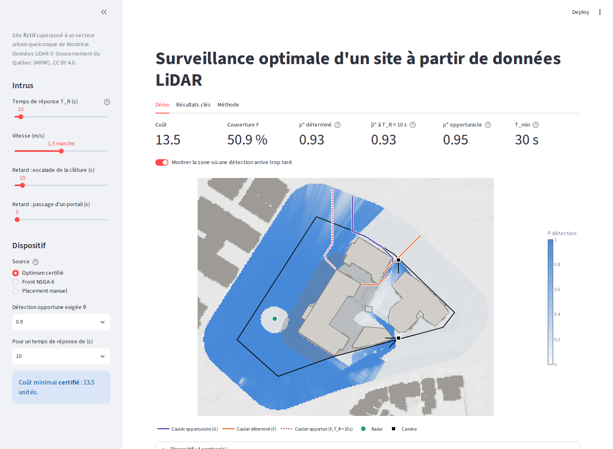
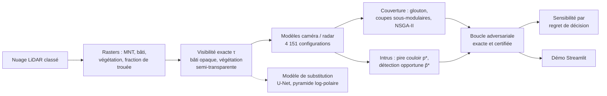

# Surveillance optimale d'un site à partir de données LiDAR aériennes

**Placer caméras et radars pour qu'un intrus qui connaît le dispositif soit détecté, et à temps.**
Nuage LiDAR 3D, recherche opérationnelle certifiée, deep learning mesuré, boucle adversariale exacte.

> **Site fictif.** Le site protégé, ses zones et ses actifs sont inventés et superposés à un secteur urbain
> quelconque de Montréal. Aucune information sur un site réel n'est produite ni publiée. Ce choix est
> délibéré : publier des cartes d'angles morts d'un site réel sensible serait inacceptable.



## Le problème

Un budget limité, 61 positions candidates (mâts, toits), deux types de capteurs (caméra orientable, radar
360°), soit **4 151 configurations**. La question classique : *comment couvrir au mieux les zones
critiques ?* C'est un problème de couverture maximale (MCLP).

Ce projet montre que cette question ne suffit pas et la remplace, en trois temps, par celle d'un ingénieur
sûreté :

| Question | Métrique | Ce qu'elle révèle |
|---|---|---|
| Le site est-il couvert ? | couverture pondérée F | rien sur le pire cas |
| L'intrus sera-t-il détecté ? | p\*, détection garantie sur le couloir le moins surveillé | des couloirs aveugles à 68 % de couverture |
| Sera-t-il détecté **à temps** ? | p̃\*, en ne comptant que les détections antérieures au temps de réponse | un dispositif « robuste » (p\* = 0,97) qui ne voit l'intrus qu'au contact du bâtiment |

## Résultats

1. **Couvrir n'est pas protéger.** 68 % de couverture peuvent laisser un couloir entièrement aveugle. À
   budget égal, l'optimum de couverture gagne 0,6 point en déplaçant un radar, et perd **67 points** de
   détection garantie.
2. **Détecter n'est pas interrompre.** Le temps d'intrusion minimal est de 30 s (un coin du bâtiment critique
   est à 1,2 m de la clôture). **Démontré** : au-delà de ce temps de réponse, aucun dispositif ne protège,
   quel que soit le budget. La solution à deux radars (p\* = 0,97) tombe à 0 dès 2,5 s de temps de réponse.
3. **La boucle optimiseur ↔ intrus peut être exacte.** Écrite comme une génération de contraintes, l'intrus
   servant d'oracle, elle converge et **certifie** : le seuil de 12,8 unités pressenti par NSGA-II est
   prouvé ; exiger une détection à temps coûte **15,4 au lieu de 28,6** pour le meilleur point du front.
4. **Le retard est le levier que les capteurs ne remplacent pas.** Avec clôture et portails à 120 s, une
   réponse en 2 minutes est couverte pour 15,4 unités ; sans retard, elle est impossible. Renforcer la
   clôture seule ne rapporte que 2,7 s : l'intrus passe par un portail.
5. **Qu'aurait coûté de se tromper ?** Le feuillage d'été et un intrus qui court suffisent à casser les
   décisions nominales ; les réparer coûte de 0,4 à 3,1 unités. Protocole et prédictions préenregistrés ;
   une prédiction a été réfutée et publiée telle quelle.
6. **Le deep learning, là où il sert.** Le goulot de calcul prévu n'existait pas (le U-Net était 2,6 fois
   plus lent que le calcul exact). Déplacé sur un vrai problème, un modèle physique simple bat les U-Net, et
   la contribution durable est une **pyramide log-polaire 38 fois moins chère** que l'horizon exact.

| Coût minimal certifié selon l'exigence | Le retard rend possibles les réponses lentes |
|---|---|
|  |  |

## Démarche



| Semaine | Contenu |
|---|---|
| 1 | Site, rasters LiDAR, validation du MNT (PDAL, MRNF), positions candidates |
| 2 | Moteur de visibilité exact (Amanatides & Woo), végétation par Beer-Lambert, capteurs, validation |
| 3 | Couverture maximale : glouton, optimum certifié par coupes sous-modulaires |
| 4 | Intrus : pire couloir (union-find), exposition, NSGA-II coût / couverture / pire cas |
| 5–6 | Modèle de substitution : références physiques, U-Net, pyramide log-polaire, validation par la décision |
| 7 | Détection opportune (EASI), boucle adversariale exacte, prix de la robustesse, sensibilité |
| 8 | Démo interactive, article |

## Rigueur

- **Un arbitre exact plutôt qu'un outil de référence.** Le moteur de visibilité était en désaccord avec
  `gdal_viewshed` ; un arbitre exact a montré que GDAL surestimait la zone visible d'environ 15 %.
- **Certifier plutôt que croire.** Chaque optimum est encadré [borne inférieure, borne supérieure] ou prouvé ;
  NSGA-II est validé contre ces bornes, la boucle adversariale contre une énumération exhaustive.
- **Mesurer avant de construire.** Le goulot de calcul a été mesuré avant d'entraîner un réseau, et chaque
  accélération de la boucle a été choisie sur une mesure.
- **Préenregistrer.** Deux protocoles fixés avant calcul : l'un a transformé un succès apparent en faux positif
  documenté, l'autre contient une prédiction réfutée. Les deux sont publiés.
- **Tester.** 90 fonctions de test (pytest) : solutions analytiques, invariances, force brute, page de démo
  exécutée de bout en bout.

## Démarrage rapide

```bash
conda create -n lidar-project -c conda-forge python=3.11 \
    pdal python-pdal gdal laspy lazrs-python rasterio "geopandas>=1.0" "shapely>=2" \
    pyproj pyogrio pyyaml matplotlib numba "scipy>=1.9" pandas pytest pymoo scikit-learn joblib \
    streamlit plotly
conda activate lidar-project
pip install torch                         # semaines 5–6 seulement (MPS sur Apple Silicon)
python -m pytest tests                    # tests
python -m streamlit run app.py            # démo (après la chaîne de calcul ci-dessous)
```

Lancer Streamlit par `python -m` garantit qu'il utilise le Python de l'environnement (et donc numba, scipy…),
et non une autre installation présente sur la machine.

**Données.** Les 4 tuiles LiDAR 2023 du MRNF (`23_2955039F08_DC`, `23_2955040F08_DC`, `23_2965039F08_DC`,
`23_2965040F08_DC`, ≈ 1,3 Go) vont dans `data/raw/`, le MNT de référence du MRNF dans
`data/external/mnt_mrnf.tif`. Le site est dessiné dans QGIS (`data/site/site.gpkg`). Les sorties de
`data/processed/` ne sont pas versionnées : elles se régénèrent.

**Chaîne de calcul**, dans l'ordre (paramètres dans `config.yaml`, détail et durées dans le
[journal](docs/journal.md#installation-et-reproduction)) :

| Étape | Commandes | Durée indicative |
|---|---|---|
| Site, rasters, validation | `src.site`, `src.rasters`, `src.validation`, `src.candidates` | quelques minutes |
| Visibilité et couverture | `src.validation_viewshed`, `src.coverage` | quelques minutes |
| Optimisation de la couverture | `src.greedy`, `src.milp`, `src.pareto`, `src.analyse` | ≈ 3 h 30 (certification) |
| Intrus et NSGA-II | `src.intrusion`, `src.intrus`, `src.evaluation_intrus`, `src.nsga`, `src.analyse_nsga` | ≈ 15 min |
| Modèle de substitution | `src.dataset_surrogate` … `src.catalogue_reduit` | ≈ 1 h 15 |
| Détection opportune, boucle, sensibilité | `src.opportune`, `src.boucle`, `src.sensibilite` | ≈ 6 h 30 sur 2 cœurs |

Chaque étape se lance par `python -m <module>`. Les figures se régénèrent sans recalcul par
`python -m src.boucle figures` et `python -m src.sensibilite figures`.

## Structure du dépôt

```
├── app.py            démo Streamlit (affichage seulement)
├── config.yaml       paramètres choisis ; aucune valeur calculée
├── src/              un module par étape (visibilité, capteurs, optimisation, intrus, boucle, …)
├── tests/            solutions analytiques, invariances, force brute, démo
├── docs/
│   ├── journal.md      le détail semaine par semaine : choix, mesures, échecs, corrections
│   ├── formulation.md  formulation mathématique et preuves
│   └── article.md      synthèse en huit étapes
├── figures/          figures versionnées
└── data/             site dessiné (versionné) ; données brutes et sorties (non versionnées)
```

## Pour aller plus loin

- [**Journal de bord**](docs/journal.md) : chaque semaine en détail, 60 choix méthodologiques justifiés,
  limites connues.
- [**Formulation**](docs/formulation.md) : modèles, propositions et preuves (couverture sous-modulaire,
  couloir p\*, détection opportune, convergence de la boucle).
- [**Article**](docs/article.md) : le projet raconté pour un lecteur pressé.

## Limites principales

- **Une seule date d'acquisition** (novembre, sans feuilles) : transmittances optimistes pour l'été ; le
  feuillage n'est simulé que par un facteur uniforme.
- **Intrus debout, omniscient, à vitesse constante** ; temps de réponse déterministe (EASI simplifié).
- **Coûts relatifs**, non calibrés sur des prix réels.
- **Semi-transparence de la végétation validée analytiquement**, pas par des mesures de terrain.
- **Sensibilité un facteur à la fois** ; optimum certifié sous l'hypothèse de détections corrélées (fusion
  max), seulement encadré sous l'hypothèse d'indépendance.

La liste complète est dans le [journal](docs/journal.md#limites-connues).

## Suite possible

- **Décision robuste multi-scénarios** : un seul dispositif qui tient sous le feuillage d'été et face à un
  intrus qui court ; la boucle s'y prête directement (un oracle d'intrus par scénario, un seul maître).
- **Optimiser capteurs et retard ensemble**, en donnant un coût au renforcement de la clôture et des portails.
- **Un second site de plusieurs km²**, où le modèle de substitution trouverait son point d'équilibre.

## Stack

PDAL, laspy, rasterio, GeoPandas, shapely · numpy, numba · scipy (HiGHS), pymoo · scikit-learn, PyTorch ·
Streamlit, plotly · pytest

---

*Données : © Gouvernement du Québec, ministère des Ressources naturelles et des Forêts (MRNF), licence
CC BY 4.0.*
