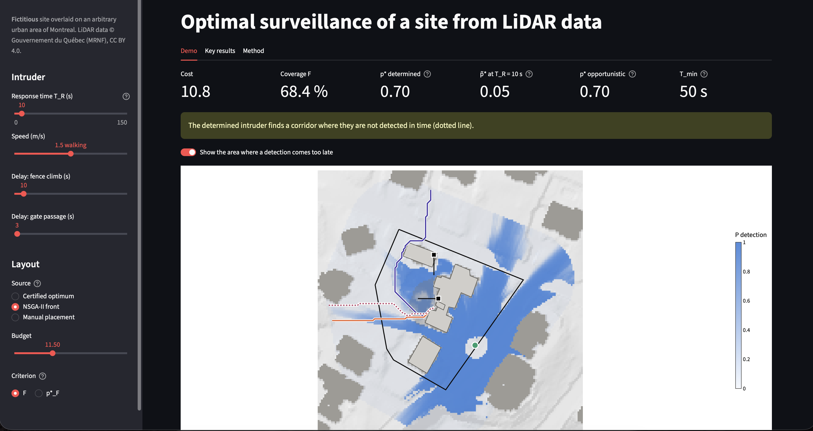
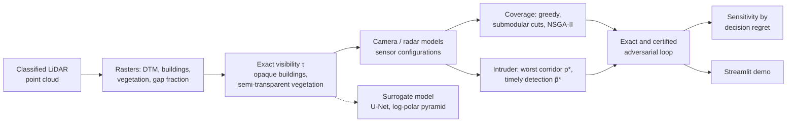

# Optimal surveillance of a site from airborne LiDAR data

**Placing cameras and radars so that an intruder who knows the layout is detected, and in time.**
3D LiDAR point cloud, certified operations research, measured deep learning, exact adversarial loop.

> **Fictitious site.** The protected site, its zones and its assets are made up and overlaid on an
> arbitrary urban area. No information about a real sensitive site is produced or published.

## The problem

A limited budget, candidate positions (masts, roofs), two sensor types (orientable camera, 360° radar),
or cameras only. The classic question: *how to best cover the critical zones?* It is a maximal covering
location problem (MCLP).

This project shows that this question is not enough and replaces it, in three stages, with the one a
security engineer asks:

| Question | Metric | What it can hide |
|---|---|---|
| Is the site covered? | weighted coverage F | nothing is said about the worst case |
| Will the intruder be detected? | p\*, guaranteed detection on the least watched corridor | a blind corridor behind a high coverage |
| Will they be detected **in time**? | p̃\*, counting only the detections earlier than the response time | a "robust" layout that only sees the intruder in contact with the target |



## Approach



| Phase | Content |
|---|---|
| 1 | Site, LiDAR rasters, DTM validation (PDAL, MRNF), candidate positions |
| 2 | Exact visibility engine (Amanatides & Woo), vegetation by Beer-Lambert, sensors, validation |
| 3 | Maximal coverage: greedy, optimum certified by submodular cuts |
| 4 | Intruder: worst corridor (union-find), exposure, NSGA-II cost / coverage / worst case |
| 5-6 | Surrogate model: physical baselines, U-Net, log-polar pyramid, validation by the decision |
| 7 | Timely detection (EASI), exact adversarial loop, price of robustness, sensitivity |
| 8 | Interactive demo |


## Rigour

- **An exact referee rather than a reference tool.** The visibility engine is compared with `gdal_viewshed`
  (`src.validation_viewshed`), and disagreements are settled by an exact ray traversal.
- **Certify rather than believe.** Each optimum is bracketed [lower bound, upper bound] or proven; NSGA-II is
  validated against these bounds, the adversarial loop against an exhaustive enumeration.
- **Measure before building.** The computational bottleneck is measured before training a network.
- **Preregister.** The sensitivity analysis and the validation of the surrogate by the decision follow
  protocols fixed in `config.yaml` before computation.
- **Test.** pytest: analytical solutions, invariances, brute force, demo page run end to end.

## Quick start

```bash
conda create -n lidar-project -c conda-forge python=3.11 \
    pdal python-pdal gdal laspy lazrs-python rasterio "geopandas>=1.0" "shapely>=2" \
    pyproj pyogrio pyyaml matplotlib numba "scipy>=1.9" pandas pytest pymoo scikit-learn joblib \
    streamlit plotly jupyter
conda activate lidar-project
pip install torch                         # surrogate model only
python -m pytest tests                    # tests
python -m src.chain                       # computation chain (below)
python -m streamlit run app.py            # demo, once the chain has run
```


**Data.** The 4 LiDAR tiles 2023 of the MRNF (≈ 1.3 GB) go in `data/raw/`, the reference DTM of the MRNF in
`data/external/dtm_mrnf.tif` (DTM validation only). The site, `data/site/site.gpkg`, is drawn in QGIS, see
[`docs/qgis_site_guide.md`](docs/qgis_site_guide.md). It is the only input of the repository: every other
file (derived site products, rasters, matrices, solutions, figures) is produced by the chain.

**Computation chain.** `python -m src.chain` runs every step in order, each one as `python -m <module>`,
with the parameters of `config.yaml`, and stops at the first failure:

| Stage | Steps |
|---|---|
| Site, rasters, candidates | `site`, `rasters`, `candidates` |
| Coverage and its optimisation | `coverage`, `greedy`, `milp`, `pareto`, `analysis` |
| Intruder and NSGA-II | `intruder_domain`, `intruder`, `intruder_evaluation`, `nsga`, `nsga_analysis` |
| Timely detection, loop, sensitivity | `timely`, `adversarial_loop`, `sensitivity` |
| Optional: validation | `validation` (DTM against PDAL / MRNF), `validation_viewshed` (against GDAL) |
| Optional: surrogate model (PyTorch) | `surrogate_dataset` ... `reduced_catalog`, `surrogate_metrics` |

```bash
python -m src.chain --list                          # the steps and their commands
python -m src.chain --until coverage                # quick check of the site
python -m src.chain --from milp                     # resume from a step
python -m src.chain --with validation surrogate     # with the optional groups
```

The certification steps (`milp`, `adversarial_loop`, `sensitivity`) take most of the time; their time limits
are in `config.yaml` (`optimization.milp`, `loop`, `sensitivity`). The figures go to `figures/`, the
tables to `data/processed/`.

**Cameras only.** Set `sensors.cameras_only: true` in `config.yaml`, then run the chain from the coverage
step (`python -m src.chain --from coverage`): no radar configuration is created, and every later step
(optimisation, intruder, loop, sensitivity, surrogate catalog, demo) works with the cameras alone.

## Repository structure

```
├── app.py            Streamlit demo (display only)
├── config.yaml       chosen parameters; no computed value
├── src/              one module per stage (visibility, sensors, optimisation, intruder, loop, ...);
│                     src/chain.py runs them in order
├── tests/            analytical solutions, invariances, brute force, demo
├── notebooks/        one notebook per phase
├── docs/
│   ├── formulation.md      mathematical formulation and proofs
│   ├── qgis_site_guide.md  drawing a site in QGIS
│   └── project_brief.md    the brief the project started from
├── figures/          figures produced by the chain
└── data/             site/site.gpkg drawn in QGIS (versioned); raw data and outputs (not versioned)
```

## Main limitations

- **A single acquisition date** (November, leaf-off): optimistic transmittances for summer; foliage is only
  simulated by a uniform factor.
- **Standing, omniscient intruder at constant speed**; deterministic response time (simplified EASI).
- **Relative costs**, not calibrated on real prices.
- **Semi-transparency of the vegetation validated analytically**, not by field measurements.
- **One-factor-at-a-time sensitivity**; optimum certified under the assumption of correlated detections
  (max fusion), only bracketed under the independence assumption.

## Possible follow-up

- **Robust multi-scenario decision**: a single layout that holds under summer foliage and against a running
  intruder; the loop lends itself to it directly (one intruder oracle per scenario, a single master).
- **Optimise sensors and delay together**, by giving a cost to the reinforcement of the fence and the gates.
- **A site of several km²**, where the surrogate model would reach its break-even point.

## Stack

PDAL, laspy, rasterio, GeoPandas, shapely · numpy, numba · scipy (HiGHS), pymoo · scikit-learn, PyTorch ·
Streamlit, plotly · pytest

---

*Data: © Gouvernement du Québec, ministère des Ressources naturelles et des Forêts (MRNF), CC BY 4.0
licence.*
