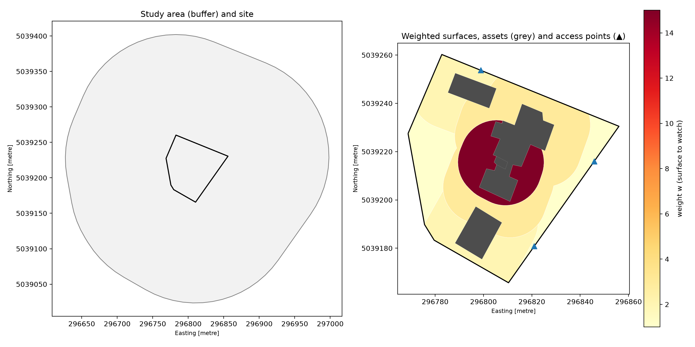

# Surveillance optimale d'un site à partir de données LiDAR aériennes

Placement optimal de capteurs de surveillance (caméras, radars) sur un site à protéger, en exploitant la
géométrie 3D d'un nuage de points LiDAR classé : bâtiments opaques, végétation semi-transparente, relief.
Le problème est traité comme un **problème de couverture maximale (MCLP)** sous contrainte de budget, puis
évalué contre un **intrus** qui cherche le chemin le moins détecté.

> **Site fictif.** Le site protégé, ses zones et ses actifs sont inventés et superposés à un secteur urbain
> quelconque de Montréal. Aucune information sur un site réel n'est produite ni publiée. Ce choix est
> délibéré : publier des cartes d'angles morts d'un site réel sensible serait inacceptable.

---

## Sommaire
1. [Problème](#problème)
2. [Avancement](#avancement)
3. [Données](#données)
4. [Installation et reproduction](#installation-et-reproduction)
5. [Semaine 1 — Site, rasters, validation, positions candidates](#semaine-1--site-rasters-validation-positions-candidates)
6. [Choix méthodologiques](#choix-méthodologiques)
7. [Limites connues](#limites-connues)
8. [Prochaines étapes](#prochaines-étapes)

---

## Problème

Un nombre limité de capteurs doit protéger un site comportant des zones plus ou moins critiques. Chaque
capteur a une position candidate (mât, toit), une hauteur et un modèle de détection (portée, champ de vision,
orientation pour une caméra ; couverture 360° et masque d'élévation pour un radar).

Trois éléments distinguent l'approche d'un simple calcul de couverture :

1. **La 3D du LiDAR** : les bâtiments bloquent la vue, la végétation l'atténue en fonction de la densité de
   points traversée. On obtient une *probabilité* de détection plutôt qu'un visible/invisible binaire.
2. **L'évaluation par un intrus** : la métrique clé est la probabilité de détection sur le chemin le moins
   surveillé (Dijkstra sur une carte de coût), de l'extérieur jusqu'à la zone critique.
3. **Un modèle de substitution (deep learning)** pour accélérer le calcul des champs de visibilité, qui est
   le goulot d'étranglement de l'optimisation.

Méthodes d'optimisation comparées : glouton (garantie (1 − 1/e) par sous-modularité), programmation linéaire
en nombres entiers (optimum exact sur petites instances), NSGA-II (front de Pareto multi-objectif).

## Avancement

| Semaine | Contenu | État |
|---|---|---|
| 1 | Site, rasters MNT/MNS/hauteurs, validation, positions candidates | ✅ |
| 2 | Moteur de visibilité (viewshed) + modèles de capteurs, validation contre GDAL | ⏳ |
| 3 | Baselines glouton et MILP, métriques de couverture | |
| 4 | Évaluation par l'intrus (pire chemin) + NSGA-II | |
| 5–6 | Modèle de substitution (U-Net) : dataset, entraînement, accélération/précision | |
| 7 | Boucle adversariale optimiseur ↔ intrus, analyse de sensibilité | |
| 8 | Démo Streamlit, article | |

## Données

| Élément | Valeur |
|---|---|
| Source | Données lidar du Québec, ministère des Ressources naturelles et des Forêts (MRNF) |
| Projet | 2023, 4 tuiles de 1 km² : `23_2955039F08_DC`, `23_2955040F08_DC`, `23_2965039F08_DC`, `23_2965040F08_DC` |
| Format | LAZ 1.4, point format 7 (intensité, temps GPS, RGB) |
| Projection | NAD83(CSRS) / MTM zone 8 — **EPSG:2950** |
| Référence verticale | **CGVD28** (absente de l'en-tête LAS ; source : index du MRNF) |
| Acquisition | **21 novembre 2023** (saison : automne) → feuillus **sans feuilles** |
| Capteur | RIEGL VQ |
| Densité | ≈ 24 impulsions/m², ≈ 30 points/m² |
| Classes présentes | 1 non classé, 2 sol, 6 bâtiment, 7 bruit, 17 tablier de pont |
| Référence de validation | MNT 1 m du MRNF (Lambert du Québec, EPSG:6622) |
| Licence | © Gouvernement du Québec, MRNF — CC BY 4.0 |

**Point important : il n'y a pas de classes de végétation (3, 4, 5).** La végétation est mélangée dans la
classe 1 avec les poteaux, fils, véhicules et équipements de toiture. Elle doit être identifiée dans le projet
(voir [Choix méthodologiques](#choix-méthodologiques)).

## Installation et reproduction

```bash
conda create -n lidar-project -c conda-forge python=3.11 \
    pdal python-pdal laspy lazrs-python rasterio "geopandas>=1.0" "shapely>=2" \
    pyproj pyogrio pyyaml matplotlib numba
conda activate lidar-project
```

Les tuiles LAZ sont à placer dans `data/raw/` (non versionnées, ≈ 1,3 Go), et la tuile MNT du MRNF dans
`data/external/mnt_mrnf.tif`. Le site est dessiné dans QGIS (`data/site/site.gpkg`, voir
`QGIS_site_tutorial.txt`). Tous les paramètres sont dans `config.yaml`.

```bash
python -m src.site                  # 1. validation du site, zones pondérées, grille
python -m src.rasters               # 2. MNT, MNS, hauteurs, indicateurs de végétation
python -m src.validation pdal       # 3a. génère le pipeline PDAL de référence
pdal pipeline data/processed/validation/mnt_pdal.json
python -m src.validation compare    # 3b. compare le MNT à PDAL et au MRNF
python -m src.candidates            # 4. positions candidates des capteurs
```

```
├── config.yaml             paramètres (entrées choisies, jamais de valeurs calculées)
├── src/
│   ├── site.py             site : validation, actifs, zones d'approche, grille
│   ├── rasters.py          rasters de base par accumulation par blocs
│   ├── validation.py       validation du MNT (PDAL, MRNF)
│   └── candidates.py       positions candidates (mâts, toits)
└── data/
    ├── raw/                tuiles LAZ (non versionnées)
    ├── external/           références externes (non versionnées)
    ├── site/               site.gpkg (dessiné) + sorties dérivées
    └── processed/          rasters et validation (régénérables)
```

---

## Semaine 1 — Site, rasters, validation, positions candidates

### 1. Le site (`src/site.py`)

Le site est dessiné dans QGIS en trois couches : `perimetre` (clôture), `zones` (partition du périmètre avec
niveau, poids, type et cible de l'intrus) et `acces` (4 portails). Le module :

- **valide** le dessin : projection, géométries valides, zones formant une partition exacte du périmètre
  (écart mesuré : 10⁻⁸ m²), poids positifs, accès sur la clôture ;
- **sépare** les *actifs* (bâtiments, équipements), qui sont les cibles de l'intrus, des *surfaces à
  surveiller* ;
- **construit** un anneau d'approche de 15 m autour de chaque actif, qui porte son poids ;
- **calcule** la zone d'étude (buffer de 400 m), la couronne de départ de l'intrus et une grille de 1 m calée
  sur des coordonnées entières (995 × 944 pixels).



| Surface à surveiller | Poids w | Surface (m²) | Part de l'objectif |
|---|---|---|---|
| Approche Bat.3 (cœur, cible de l'intrus) | 10 | 3 255 | **66,9 %** |
| Approche Bat.1 | 5 | 1 603 | 16,5 % |
| Périphérie | 1 | 4 362 | 9,0 % |
| Approche Bat.4 | 4 | 565 | 4,6 % |
| Approche Bat.2 | 4 | 223 | 1,8 % |
| Approche Gaz Bat.3 | 4 | 119 | 1,0 % |
| Approche Générateur | 4 | 29 | 0,2 % |

### 2. Les rasters (`src/rasters.py`)

Les 4 tuiles (≈ 127 millions de points, dont 27 millions dans la grille) sont lues par blocs de 5 millions de
points. Pour chaque bloc, chaque point est affecté à son pixel et des statistiques fusionnables (nombre,
somme, min, max) sont accumulées par classe. La mémoire reste constante quel que soit le volume.

| Produit | Définition |
|---|---|
| `mnt.tif` | moyenne des points sol par pixel ; pixels sans sol comblés par interpolation |
| `mnt_comble.tif` | masque des pixels interpolés (20,8 % de la grille, essentiellement sous les bâtiments) |
| `mns.tif` | maximum de toutes les classes sauf bruit |
| `bati_mask.tif`, `bati_h.tif` | présence et hauteur des bâtiments (22,6 % de la grille, jusqu'à 100 m) |
| `autre_h.tif` | hauteur de la classe 1 au-dessus du sol |
| `autre_frac_multi.tif` | part des points de classe 1 issus d'impulsions à retours multiples (indicateur de végétation) |
| `densite.tif` | points/m² (médiane : 25) |

### 3. Validation du MNT (`src/validation.py`)

Deux références indépendantes, deux questions différentes :

| Référence | Question | Sol | n pixels | Biais | RMSE | NMAD | \|écart\| p99 |
|---|---|---|---|---|---|---|---|
| **PDAL** `writers.gdal` (binmode, mean), zone test 295 × 244 px | la mise en grille est-elle exacte ? | mesuré | 59 426 | 0,000 m | **0,003 m** | 0,000 m | 0,007 m |
| **MNT du MRNF** (EPSG:6622, rééchantillonné bilinéaire) | la chaîne complète est-elle plausible ? | mesuré | 744 271 | 0,000 m | 0,093 m | **0,013 m** | 0,244 m |
| | | interpolé | 195 009 | +0,023 m | 0,507 m | 0,117 m | 2,21 m |

**Lecture.**
- **PDAL** : l'écart est millimétrique (dû aux points situés exactement sur une limite de pixel). La mise en
  grille maison (alignement, convention des lignes, moyenne) est **validée**.
- **MRNF, sol mesuré** : biais nul et NMAD de 1,3 cm. La RMSE de 9 cm est du même ordre que le bruit
  introduit par le seul rééchantillonnage entre projections (≈ 8 cm RMSE, mesuré par un test aller-retour
  MTM 8 → Lambert → MTM 8). L'accord est donc au niveau du bruit de la méthode de comparaison.
- **MRNF, sol interpolé** : écarts plus forts (p99 ≈ 2 m) sous les bâtiments, où chaque producteur interpole
  différemment. Sans conséquence : la visibilité n'est jamais évaluée sous un bâtiment.
- **Limite** : le MNT du MRNF est très probablement issu du même vol. Cette comparaison valide le
  *traitement*, pas la *mesure* LiDAR.

### 4. Positions candidates (`src/candidates.py`)

| Type | Nombre | Altitude du support (moy.) | Hauteurs possibles | Coût relatif |
|---|---|---|---|---|
| Mât le long de la clôture (tous les 20 m, recul 1 m) | 19 | 113,6 m | 4, 6, 8, 10 m | 1,0 + 0,10/m |
| Mât intérieur (grille de 25 m) | 8 | 112,9 m | 4, 6, 8, 10 m | 1,0 + 0,10/m |
| Coin de toit (recul 1,5 m) | 34 | 138,0 m | 2, 4 m | 0,8 + 0,10/m |
| **Total** | **61 positions** | | **176 couples (position, hauteur)** | |

11 mâts sur 27 tombent dans une végétation de plus de 3 m : premier signe du poids de la végétation dans les
résultats. Ils sont conservés et signalés ; l'optimiseur décidera.

---

## Choix méthodologiques

**Organisation**
1. **Une seule projection (EPSG:2950)** pour toutes les données, celle du LiDAR, en mètres. Le site est
   dessiné directement dans cette projection.
2. **`config.yaml` ne contient que des paramètres choisis** ; tout ce qui est calculé (grille, zones dérivées)
   est écrit dans des fichiers de sortie régénérables.
3. **Une grille unique** (`grid.yaml`) calée sur des coordonnées entières : tous les rasters sont alignés au
   pixel près.

**Modélisation du site**
4. **On surveille les abords, pas les toits.** Les emprises des bâtiments sont des *actifs* (cibles de
   l'intrus, obstacles opaques) ; le poids est porté par un anneau d'approche au sol de 15 m.
5. **Règle du maximum** là où des anneaux se chevauchent : une surface est aussi critique que l'actif le plus
   important qu'elle dessert. Implémentée en attribuant les surfaces par priorité décroissante.
6. **Les équipements ponctuels** (gaz, générateur) pèsent moins de 1 % d'un objectif pondéré par la surface ;
   ils seront traités par une **contrainte de k-couverture** (chaque point vulnérable vu par au moins k
   capteurs) plutôt que par un poids. Exemple : l'anneau de « Gaz Bat.1 » est entièrement absorbé par ceux de
   Bat.3 et Bat.1.
7. **Faiblesse volontairement conservée** : Bat.3 (cœur) est à moins de 15 m de la clôture, avec un accès dans
   son anneau. Cas test pour l'intrus de la semaine 4.

**Traitement LiDAR**
8. **Accumulation par blocs plutôt que chargement complet** : nombre, somme, min et max sont fusionnables,
   ce qui garantit une mémoire constante et un alignement exact contrôlé par le code.
9. **MNT = moyenne des points sol** (≈ 12 par pixel), plus robuste au bruit de mesure que le minimum.
10. **Les pixels interpolés sont tracés** (`mnt_comble.tif`) pour distinguer mesure et interpolation dans
    toutes les analyses.
11. **Végétation non classée** : premier indicateur = part des retours multiples dans la classe 1 (un
    feuillage produit plusieurs échos, un toit ou un poteau un seul).
12. **Vol sans feuilles** (21 novembre) : la végétation feuillue sera plus transparente qu'en été. Ce point
    sera exploité dans l'analyse de sensibilité à la saison.
13. **Objets en toiture** : des points de classe 1 atteignent 50 à 74 m au-dessus du sol (antennes,
    équipements). La classe 1 au-dessus des bâtiments ne doit pas être prise pour de la végétation.
14. **Contrôle croisé dessin ↔ LiDAR** : un coin de toit dessiné qui ne tombe pas sur `bati_mask` est
    rejeté.

**Validation**
15. **Deux références, deux questions** : PDAL valide la mise en grille, le MRNF la chaîne complète.
    Indicateurs : biais, RMSE, NMAD (robuste, standard pour les MNT), 99ᵉ centile, calculés séparément sur
    le sol mesuré et le sol interpolé.

## Limites connues

- Végétation non séparée des autres objets de classe 1 (poteaux, véhicules, clôtures).
- Une seule date d'acquisition (automne, sans feuilles).
- Référence verticale CGVD28, non inscrite dans les fichiers LAS : à surveiller si d'autres sources sont
  ajoutées (CGVD2013).
- Coûts des capteurs en unités relatives, non calibrés sur des prix réels.

## Prochaines étapes

- **Voxels de végétation** : densité 3D de la classe 1 hors bâtiments, normalisée par le nombre d'impulsions
  de la colonne, pour une atténuation de type Beer–Lambert.
- **Moteur de visibilité** (numba) avec modèles de caméra et de radar, validé contre `gdal_viewshed`.
- Baselines glouton et MILP sur les 176 couples (position, hauteur).

---

*Données : © Gouvernement du Québec, MRNF, licence CC BY 4.0.*


## Validation du moteur de visibilité

Le moteur calcule, pour chaque couple (position, hauteur), l'épaisseur optique τ
de la ligne de visée vers chaque cellule dans un rayon de 400 m : τ = ∞ si un
prisme opaque (terrain, bâti) est touché, τ = Σ k·ℓ sinon (Beer-Lambert dans la
végétation). Parcours exact des cellules traversées (Amanatides & Woo, 1987),
compilé avec numba : ~16 ms par calcul sur 5·10⁵ cellules.

### 1. Tests analytiques — `tests/test_viewshed.py`

Cinq terrains synthétiques à solution exacte, chacun isolant un terme du modèle :
terrain plat (géométrie du disque), mur (longueur d'ombre par Thalès), dalle de
végétation infinie (τ = k × longueur 3D, axe et diagonale), dalle partielle
(entrée du rayon dans la canopée), exclusion du pixel du mât. Tolérance
relative 10⁻⁵ : le parcours exact reproduit les formules à la précision float32.

### 2. Comparaison externe à `gdal_viewshed`

**Protocole.** Même surface (MNS entièrement opaque), mêmes hauteurs observateur
et cible (1,0 m), courbure désactivée (`-cc 0` ; d²/2R = 1,3 cm à 400 m),
observateur au centre de cellule. Seule différence : l'algorithme (parcours exact
ici ; interpolation de l'horizon de Wang, Robinson & White 2000 dans GDAL).
144 couples comparés. 32 couples exclus : capteur sous le MNS (mât dans la
végétation), cas qu'un outil 2,5D ne peut pas représenter et que ce moteur traite
par semi-transparence.

**Critères fixés avant l'expérience et résultats**

| Critère | Seuil | Résultat |
|---|---|---|
| κ de Cohen médian | ≥ 0,85 | 0,870 ✅ |
| IoU médian des zones visibles | ≥ 0,85 | 0,779 ❌ |
| Désaccords à ≤ 2 px d'une frontière | ≥ 80 % | 86,1 % ✅ |

IoU agrégé (pondéré par la surface visible) : [0,804].

### 3. Analyse de l'échec sur l'IoU

| Hypothèse | Test | Verdict |
|---|---|---|
| Effet de taille : l'IoU est instable pour les petites zones visibles | ρ(IoU, part visible) = [0,79] ; IoU médian de [0,598] (< 0,5 % visible) à [0,820] (> 5 %) | Confirmée : explique la queue, pas le plateau |
| Rayons rasants (capteur à peine au-dessus du MNS) | ρ(κ, hauteur au-dessus du MNS) = [−0,22] | Rejetée |
| Décalage uniforme de l'horizon entre les moteurs | IoU en fonction d'une tolérance ε : non monotone | Rejetée |
| Obstacle au voisinage immédiat du mât | 1 % des désaccords > 1 m dus à un obstacle à < 3 m | Rejetée |
| **Un des deux moteurs est inexact** | **Arbitre exact** sur les cellules de désaccord | **Confirmée — voir ci-dessous** |

**Arbitre exact.** Pour le modèle de surface en prismes (chaque pixel = prisme de
hauteur MNS), la visibilité a une solution exacte : parcourir toutes les cellules
traversées par le segment et comparer le point le plus bas du rayon dans chaque
cellule au sommet du prisme. Appliqué aux cellules de désaccord :

- **GDAL** : 100 % des cellules qu'il est seul à voir sont en réalité masquées.
  Son interpolation de l'horizon « fait fuir » la visibilité par-dessus les
  obstacles, ce qui surestime la zone visible d'environ 15 % (cas médian).
- **Version initiale de ce moteur** (échantillonnage du rayon tous les 0,5 px) :
  17 à 26 % des cellules qu'il était seul à voir étaient masquées, parce que
  l'échantillonnage manquait les cellules effleurées par un coin. Soit environ 1 %
  de faux visible. **Corrigé** en remplaçant l'échantillonnage par le parcours
  exact, qui donne aussi la longueur exacte traversée dans la végétation et
  divise le temps de calcul par 1,7. Après correction, accord de 100 % avec
  l'arbitre.

**Conclusion.** L'écart résiduel avec GDAL vient de l'approximation de GDAL, pas
d'une erreur de ce moteur. Le critère d'IoU ≥ 0,85 était mal calibré : la
variabilité entre algorithmes de visibilité est connue (Fisher, 1993) et plus
forte que ce que j'avais anticipé en tissu urbain dense. Le modèle en prismes est
le plus conservateur des deux (il épaissit les obstacles jusqu'à un pixel) : il
sous-estime la couverture plutôt que de la surestimer, ce qui est le bon côté de
l'erreur pour un système de sûreté.

### Limites

- Résolution de 1 m : la géométrie sous le pixel (bords de toits, cimes) n'est pas
  représentée. Le modèle en prismes est une borne conservative.
- Végétation : couche homogène du sol au sommet (pas de base de houppier), angle
  des feuilles supposé sphérique (G = 0,5), acquisition sans feuilles
  (novembre 2023) : les transmittances sont optimistes pour l'été.
- Le mode de validation traite la végétation comme opaque. La semi-transparence
  est validée seulement par les tests analytiques, faute de référence externe.