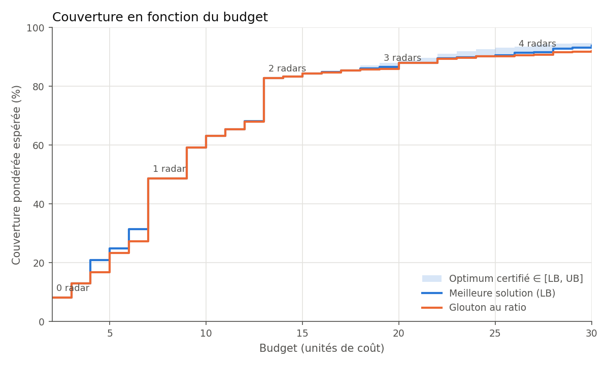
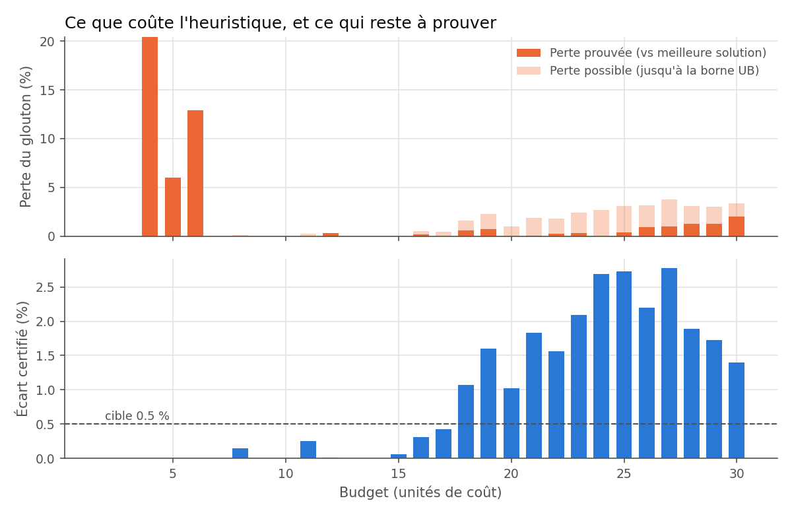
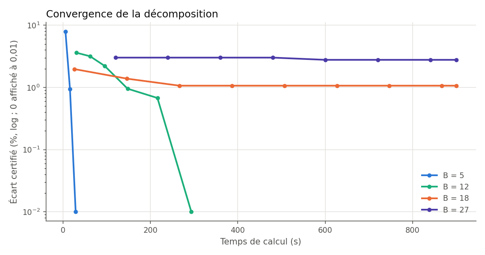
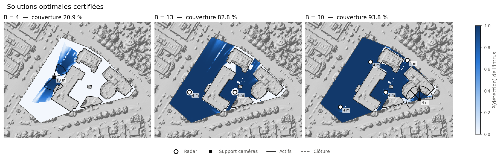
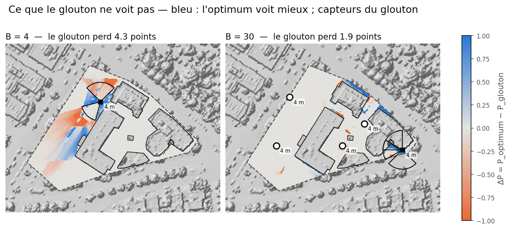

# Surveillance optimale d'un site à partir de données LiDAR aériennes

Placement optimal de capteurs de surveillance (caméras, radars) sur un site à protéger, en exploitant la
géométrie 3D d'un nuage de points LiDAR classé : bâtiments opaques, végétation semi-transparente, relief.
Le problème est traité comme un **problème de couverture maximale (MCLP)** sous contrainte de budget, puis
évalué contre un **intrus** qui cherche le chemin le moins détecté.

> **Site fictif.** Le site protégé, ses zones et ses actifs sont inventés et superposés à un secteur urbain
> quelconque de Montréal. Aucune information sur un site réel n'est produite ni publiée. Ce choix est
> délibéré : publier des cartes d'angles morts d'un site réel sensible serait inacceptable.

---

## Sommaire
1. [Problème](#problème)
2. [Avancement](#avancement)
3. [Données](#données)
4. [Installation et reproduction](#installation-et-reproduction)
5. [Semaine 1 — Site, rasters, validation, positions candidates](#semaine-1--site-rasters-validation-positions-candidates)
6. [Semaine 2 — Visibilité, capteurs, matrice de couverture](#semaine-2--visibilité-capteurs-matrice-de-couverture)
7. [Semaine 3 — Optimisation : glouton et optimum certifié](#semaine-3--optimisation--glouton-et-optimum-certifié)
8. [Choix méthodologiques](#choix-méthodologiques)
9. [Limites connues](#limites-connues)
10. [Prochaines étapes](#prochaines-étapes)

---

## Problème

Un nombre limité de capteurs doit protéger un site comportant des zones plus ou moins critiques. Chaque
capteur a une position candidate (mât, toit), une hauteur et un modèle de détection (portée, champ de vision,
orientation pour une caméra ; couverture 360° et masque d'élévation pour un radar).

Trois éléments distinguent l'approche d'un simple calcul de couverture :

1. **La 3D du LiDAR** : les bâtiments bloquent la vue, la végétation l'atténue en fonction de la densité de
   points traversée. On obtient une *probabilité* de détection plutôt qu'un visible/invisible binaire.
2. **L'évaluation par un intrus** : la métrique clé est la probabilité de détection sur le chemin le moins
   surveillé (Dijkstra sur une carte de coût), de l'extérieur jusqu'à la zone critique.
3. **Un modèle de substitution (deep learning)** pour accélérer le calcul des champs de visibilité, qui est
   le goulot d'étranglement de l'optimisation.

Méthodes d'optimisation comparées : glouton au ratio gain/coût (heuristique rapide, sans garantie avec des
coûts de support partagés), optimum certifié par décomposition en coupes sous-modulaires (encadrement
[borne inférieure, borne supérieure] de l'optimum), et NSGA-II (front de Pareto multi-objectif).

## Avancement

| Semaine | Contenu | État |
|---|---|---|
| 1 | Site, rasters MNT/MNS/hauteurs, validation, positions candidates | ✅ |
| 2 | Moteur de visibilité exact, validation (tests analytiques, GDAL, arbitre exact), modèles caméra/radar, matrice de couverture | ✅ |
| 3 | Formulation, glouton, optimum certifié (coupes sous-modulaires), front couverture/budget, cartes | ✅ |
| 4 | Évaluation par l'intrus (pire chemin) + NSGA-II | |
| 5–6 | Modèle de substitution (U-Net) : dataset, entraînement, accélération/précision | |
| 7 | Boucle adversariale optimiseur ↔ intrus, analyse de sensibilité | |
| 8 | Démo Streamlit, article | |

## Données

| Élément | Valeur |
|---|---|
| Source | Données lidar du Québec, ministère des Ressources naturelles et des Forêts (MRNF) |
| Projet | 2023, 4 tuiles de 1 km² : `23_2955039F08_DC`, `23_2955040F08_DC`, `23_2965039F08_DC`, `23_2965040F08_DC` |
| Format | LAZ 1.4, point format 7 (intensité, temps GPS, RGB) |
| Projection | NAD83(CSRS) / MTM zone 8 — **EPSG:2950** |
| Référence verticale | **CGVD28** (absente de l'en-tête LAS ; source : index du MRNF) |
| Acquisition | **21 novembre 2023** (saison : automne) → feuillus **sans feuilles** |
| Capteur | RIEGL VQ |
| Densité | ≈ 24 impulsions/m², ≈ 30 points/m² |
| Classes présentes | 1 non classé, 2 sol, 6 bâtiment, 7 bruit, 17 tablier de pont |
| Référence de validation | MNT 1 m du MRNF (Lambert du Québec, EPSG:6622) |
| Licence | © Gouvernement du Québec, MRNF — CC BY 4.0 |

**Point important : il n'y a pas de classes de végétation (3, 4, 5).** La végétation est mélangée dans la
classe 1 avec les poteaux, fils, véhicules et équipements de toiture. Elle doit être identifiée dans le projet
(voir [Choix méthodologiques](#choix-méthodologiques)).

## Installation et reproduction

```bash
conda create -n lidar-project -c conda-forge python=3.11 \
    pdal python-pdal gdal laspy lazrs-python rasterio "geopandas>=1.0" "shapely>=2" \
    pyproj pyogrio pyyaml matplotlib numba "scipy>=1.9" pandas pytest
conda activate lidar-project
```

Les tuiles LAZ sont à placer dans `data/raw/` (non versionnées, ≈ 1,3 Go), et la tuile MNT du MRNF dans
`data/external/mnt_mrnf.tif`. Le site est dessiné dans QGIS (`data/site/site.gpkg`, voir
`QGIS_site_tutorial.txt`). Tous les paramètres sont dans `config.yaml`.

```bash
python -m src.site                  # 1. validation du site, zones pondérées, grille
python -m src.rasters               # 2. MNT, MNS, hauteurs, végétation, fraction de trouée
python -m src.validation pdal       # 3a. génère le pipeline PDAL de référence
pdal pipeline data/processed/validation/mnt_pdal.json
python -m src.validation compare    # 3b. compare le MNT à PDAL et au MRNF
python -m src.candidates            # 4. positions candidates des capteurs
python -m pytest tests              # 5. tests analytiques (moteur de visibilité, capteurs)
python -m src.validation_viewshed   # 6. validation externe contre gdal_viewshed
python -m src.validation_viewshed diag C034 4   #    diagnostic d'un couple (arbitre exact)
python -m src.sensors C052 4        # 7. démo : surface efficace par capteur pour un candidat
python -m src.coverage              # 8. matrice de couverture du MCLP
python -m src.greedy                # 9. glouton, balayage du budget (< 1 s)
python -m src.milp                  # 10. optimum certifié, balayage du budget (≈ 3 h 30)
python -m src.pareto                # 11. front couverture/budget, écarts, convergence
python -m src.analyse               # 12. cartes des solutions, bilan par zone
```

```
├── config.yaml                 paramètres (entrées choisies, jamais de valeurs calculées)
├── src/
│   ├── site.py                 site : validation, actifs, zones d'approche, grille
│   ├── rasters.py              rasters de base par accumulation par blocs
│   ├── validation.py           validation du MNT (PDAL, MRNF)
│   ├── candidates.py           positions candidates (mâts, toits)
│   ├── viewshed.py             épaisseur optique τ de la ligne de visée (numba)
│   ├── validation_viewshed.py  comparaison à gdal_viewshed, diagnostic, arbitre exact
│   ├── sensors.py              modèles caméra (EN 62676-4) et radar (Swerling I)
│   ├── coverage.py             matrice de couverture creuse (configurations × cellules)
│   ├── instance.py             instance d'optimisation : évaluation exacte, contraintes
│   ├── greedy.py               glouton au ratio gain/coût
│   ├── milp.py                 optimum certifié par coupes sous-modulaires multi-blocs
│   ├── pareto.py               front couverture/budget, écarts, convergence
│   └── analyse.py              cartes des solutions, bilan par zone
├── tests/
│   ├── test_viewshed.py        solutions analytiques du moteur de visibilité
│   ├── test_sensors.py         propriétés des modèles de capteurs, contrôle de configuration
│   ├── test_greedy.py          glouton contre force brute, cas construits
│   └── test_milp.py            optimum exact sur instances jouets, validité des coupes
├── docs/
│   └── formulation.md          formulation mathématique et preuves (semaine 3)
├── figures/                    figures versionnées reprises dans ce README
└── data/
    ├── raw/                    tuiles LAZ (non versionnées)
    ├── external/               références externes (non versionnées)
    ├── site/                   site.gpkg (dessiné) + sorties dérivées
    └── processed/              rasters, visibilités, validation, couverture (régénérables)
```

---

## Semaine 1 — Site, rasters, validation, positions candidates

### 1. Le site (`src/site.py`)

Le site est dessiné dans QGIS en trois couches : `perimetre` (clôture), `zones` (partition du périmètre avec
niveau, poids, type et cible de l'intrus) et `acces` (4 portails). Le module :

- **valide** le dessin : projection, géométries valides, zones formant une partition exacte du périmètre
  (écart mesuré : 10⁻⁸ m²), poids positifs, accès sur la clôture ;
- **sépare** les *actifs* (bâtiments, équipements), qui sont les cibles de l'intrus, des *surfaces à
  surveiller* ;
- **construit** un anneau d'approche de 15 m autour de chaque actif, qui porte son poids ;
- **calcule** la zone d'étude (buffer de 400 m), la couronne de départ de l'intrus et une grille de 1 m calée
  sur des coordonnées entières (995 × 944 pixels).


| Surface à surveiller | Poids w | Surface (m²) | Part de l'objectif |
|---|---|---|---|
| Approche Bat.3 (cœur, cible de l'intrus) | 10 | 3 255 | **66,9 %** |
| Approche Bat.1 | 5 | 1 603 | 16,5 % |
| Périphérie | 1 | 4 362 | 9,0 % |
| Approche Bat.4 | 4 | 565 | 4,6 % |
| Approche Bat.2 | 4 | 223 | 1,8 % |
| Approche Gaz Bat.3 | 4 | 119 | 1,0 % |
| Approche Générateur | 4 | 29 | 0,2 % |

### 2. Les rasters (`src/rasters.py`)

Les 4 tuiles (≈ 127 millions de points, dont 27 millions dans la grille) sont lues par blocs de 5 millions de
points. Pour chaque bloc, chaque point est affecté à son pixel et des statistiques fusionnables (nombre,
somme, min, max) sont accumulées par classe. La mémoire reste constante quel que soit le volume.

| Produit | Définition |
|---|---|
| `mnt.tif` | moyenne des points sol par pixel ; pixels sans sol comblés par interpolation |
| `mnt_comble.tif` | masque des pixels interpolés (20,8 % de la grille, essentiellement sous les bâtiments) |
| `mns.tif` | maximum de toutes les classes sauf bruit |
| `bati_mask.tif`, `bati_h.tif` | présence et hauteur des bâtiments (22,6 % de la grille, jusqu'à 100 m) |
| `autre_h.tif` | hauteur de la classe 1 au-dessus du sol |
| `autre_frac_multi.tif` | part des points de classe 1 issus d'impulsions à retours multiples (indicateur de végétation) |
| `densite.tif` | points/m² (médiane : 25) |

### 3. Validation du MNT (`src/validation.py`)

Deux références indépendantes, deux questions différentes :

| Référence | Question | Sol | n pixels | Biais | RMSE | NMAD | \|écart\| p99 |
|---|---|---|---|---|---|---|---|
| **PDAL** `writers.gdal` (binmode, mean), zone test 295 × 244 px | la mise en grille est-elle exacte ? | mesuré | 59 426 | 0,000 m | **0,003 m** | 0,000 m | 0,007 m |
| **MNT du MRNF** (EPSG:6622, rééchantillonné bilinéaire) | la chaîne complète est-elle plausible ? | mesuré | 744 271 | 0,000 m | 0,093 m | **0,013 m** | 0,244 m |
| | | interpolé | 195 009 | +0,023 m | 0,507 m | 0,117 m | 2,21 m |

**Lecture.**
- **PDAL** : l'écart est millimétrique (dû aux points situés exactement sur une limite de pixel). La mise en
  grille maison (alignement, convention des lignes, moyenne) est **validée**.
- **MRNF, sol mesuré** : biais nul et NMAD de 1,3 cm. La RMSE de 9 cm est du même ordre que le bruit
  introduit par le seul rééchantillonnage entre projections (≈ 8 cm RMSE, mesuré par un test aller-retour
  MTM 8 → Lambert → MTM 8). L'accord est donc au niveau du bruit de la méthode de comparaison.
- **MRNF, sol interpolé** : écarts plus forts (p99 ≈ 2 m) sous les bâtiments, où chaque producteur interpole
  différemment. Sans conséquence : la visibilité n'est jamais évaluée sous un bâtiment.
- **Limite** : le MNT du MRNF est très probablement issu du même vol. Cette comparaison valide le
  *traitement*, pas la *mesure* LiDAR.

### 4. Positions candidates (`src/candidates.py`)

| Type | Nombre | Altitude du support (moy.) | Hauteurs possibles | Coût relatif |
|---|---|---|---|---|
| Mât le long de la clôture (tous les 20 m, recul 1 m) | 19 | 113,6 m | 4, 6, 8, 10 m | 1,0 + 0,10/m |
| Mât intérieur (grille de 25 m) | 8 | 112,9 m | 4, 6, 8, 10 m | 1,0 + 0,10/m |
| Coin de toit (recul 1,5 m) | 34 | 138,0 m | 2, 4 m | 0,8 + 0,10/m |
| **Total** | **61 positions** | | **176 couples (position, hauteur)** | |

11 mâts sur 27 tombent dans une végétation de plus de 3 m : premier signe du poids de la végétation dans les
résultats. Ils sont conservés et signalés ; l'optimiseur décidera.

## Semaine 2 — Visibilité, capteurs, matrice de couverture

**Idée directrice : séparer la géométrie du capteur.** Pour chaque couple (position, hauteur), le moteur
calcule une seule fois, sur 360°, l'épaisseur optique τ de la ligne de visée vers chaque cellule :
τ = ∞ si un obstacle opaque est touché, τ = Σ kᵢ·ℓᵢ sinon (végétation traversée). Chaque capteur applique
ensuite son propre modèle, pour un coût de calcul négligeable :

P_det(x) = T(x) × P_capteur(distance, angles), avec T = e^(−α·τ)

- les orientations (azimut des caméras, inclinaison des radars) ne demandent aucun nouveau calcul de
  visibilité : **176 calculs de τ** pour **4 928 configurations** ;
- le coefficient α distingue les capteurs (un radar traverse mieux le feuillage qu'une caméra) ;
- on stocke τ, qui reste linéaire, plutôt que T.

### 1. Végétation semi-transparente : fraction de trouée (`src/rasters.py`)

**Modèle.** Loi de Beer-Lambert : la fraction de trouée verticale vaut P_gap = e^(−k·h_veg), d'où
k = −ln(P_gap) / h_veg [m⁻¹]. Avec une distribution sphérique des angles de feuilles (G = 0,5), le même k
s'applique aux rayons obliques.

**Estimateur.** Premiers retours uniquement (un retour n° 2 au sol n'existe que parce que l'impulsion a déjà
touché quelque chose), avec correction de Laplace : P̂_gap = (n_sol + 0,5) / (n + 1). Sans elle, un pixel
sans retour sol donnerait k = ∞.

| Surface | P_gap p10 / p50 / p90 | Lecture |
|---|---|---|
| Sol nu | 0,83 / 0,93 / 0,98 | 1 à 2 impulsions sur 22 touchent un objet bas de classe 1 (herbe, bordure). Sans effet : k n'est calculé qu'au-dessus de 0,3 m. |
| Bâtiments | 0,02 / 0,02 / 0,10 | Plancher de Laplace 0,5/23 : aucune impulsion n'atteint le sol. |
| Végétation > 2 m | 0,02 / 0,25 / 0,72 | Érables sans feuilles et conifères (p10 au plancher). |

Premiers retours par pixel : 22 (médiane).

| P_gap (arbre de 11 m) | k (m⁻¹) | Transmittance sur 10 m de branches |
|---|---|---|
| 0,72 (p90) | 0,03 | 0,74 |
| 0,25 (médiane) | 0,13 | 0,28 |
| 0,02 (p10) | 0,36 | 0,03 |

Le même estimateur traite les **objets pleins** sans règle supplémentaire : une voiture n'a aucun premier
retour au sol (k ≈ 2,7 m⁻¹ sur 1,5 m), un rayon qui la traverse sur 3 m a une transmittance d'environ
3·10⁻⁴.

**Bruit et biais.** Avec 22 impulsions, l'écart-type binomial de P̂_gap est d'environ ±0,09 par pixel. Pas de
lissage : τ additionne une dizaine de pixels le long du rayon, et ce bruit indépendant s'y moyenne. Comme
−ln est convexe, le bruit biaise k légèrement vers le haut (inégalité de Jensen) : l'erreur est pessimiste.

### 2. Moteur de visibilité (`src/viewshed.py`)

| Élément | Choix |
|---|---|
| Surface opaque | MNT + hauteur du bâti |
| Couche de végétation | du MNT à MNT + `autre_h` (si > 0,3 m), coefficient k |
| Cible | MNT + 1,0 m (centre du torse d'un intrus debout) |
| Observateur | altitude du support + hauteur du mât |
| Portée | 400 m ; courbure négligée (d²/2R = 1,3 cm à 400 m) |
| Algorithme | parcours exact de toutes les cellules traversées (Amanatides & Woo, 1987) |
| Codage | NaN = hors portée, ∞ = bloqué, T = e^(−τ) sinon |

Dans chaque cellule traversée, le rayon est bloqué si son point le plus bas (entrée ou sortie de la cellule)
passe sous la surface opaque. Sinon, la fraction exacte du passage située sous la canopée contribue
k · fraction · longueur 3D. On utilise la **longueur 3D** : un rayon qui plonge traverse plus de végétation
par mètre au sol. Les cellules du mât et de la cible sont exclues par convention.

**Performance** : environ **16 ms** par calcul sur 5·10⁵ cellules (numba, parallèle).

**Premiers constats**
- **Un coin de toit ne voit qu'environ un quart des directions.** Sur les autres, le rayon doit d'abord
  franchir le toit : pour un capteur 4 m au-dessus d'un bâtiment de 24 m, le sol n'est revu qu'à environ
  L × 24/4 derrière le bord (180 m pour L = 30 m).
- **Un mât dans les arbres voit à travers les branches, pas par-dessus.** Aucun obstacle opaque près du mât,
  mais une visibilité surtout partielle. Passer de 4 à 10 m aide un peu entre 25 et 100 m, sans lever les
  obstacles bâtis.

### 3. Tests analytiques (`tests/test_viewshed.py`)

Cinq terrains synthétiques à solution exacte, chacun isolant un terme du modèle :

| Test | Terme vérifié | Solution de référence |
|---|---|---|
| Terrain plat | géométrie du disque, codage NaN / 0 | exact |
| Mur | occultation opaque | longueur d'ombre D* = D_w·(h − t)/(h − H_w) (Thalès) |
| Dalle de végétation infinie | Beer-Lambert, longueur 3D, axe et diagonale | τ = k × longueur 3D hors cellules extrêmes |
| Dalle partielle | entrée du rayon dans la canopée | fraction (H_v − t)/(h − t) du trajet |
| Pixel du mât | convention d'exclusion | exact |

Tolérance relative de 10⁻⁵ : le parcours exact reproduit les formules à la précision du float32.

### 4. Validation externe contre `gdal_viewshed`

**Protocole.** Même surface (MNS entièrement opaque), mêmes hauteurs d'observateur et de cible (1,0 m),
courbure désactivée (`-cc 0`), observateur au centre de cellule. Seule différence : l'algorithme (parcours
exact ici, interpolation de l'horizon de Wang, Robinson & White, 2000, dans GDAL). **144 couples comparés.**
32 couples exclus, car le capteur est sous le MNS (mât dans la végétation) : un outil 2,5D ne peut pas
représenter ce cas, que ce moteur traite par semi-transparence.

**Critères fixés avant l'expérience**

| Critère | Seuil | Résultat |
|---|---|---|
| κ de Cohen médian | ≥ 0,85 | 0,870 ✅ |
| IoU médian des zones visibles | ≥ 0,85 | 0,779 ❌ |
| Désaccords à ≤ 2 px d'une frontière de visibilité | ≥ 80 % | 86,1 % ✅ |

IoU agrégé (pondéré par la surface visible) : 0,804. On suit le κ plutôt que le seul pourcentage d'accord
(99,2 %) : avec environ 80 % de cellules invisibles, l'accord brut est gonflé par le hasard.

**Analyse de l'échec sur l'IoU**

| Hypothèse | Test | Verdict |
|---|---|---|
| Effet de taille : l'IoU est instable pour les petites zones visibles | ρ(IoU, part visible) = 0,79 ; IoU médian de 0,60 (< 0,5 % visible) à 0,82 (> 5 %) | Confirmée : explique la queue, pas le plateau |
| Rayons rasants (capteur à peine au-dessus du MNS) | ρ(κ, hauteur au-dessus du MNS) = −0,22 | Rejetée |
| Décalage uniforme de l'horizon entre les moteurs | IoU en fonction d'une tolérance ε : non monotone | Rejetée |
| Obstacle au voisinage immédiat du mât | 1 % des désaccords > 1 m dus à un obstacle à < 3 m | Rejetée |
| **Un des deux moteurs est inexact** | **Arbitre exact** sur les cellules de désaccord | **Confirmée** |

**Arbitre exact.** Pour le modèle en prismes (chaque pixel est un prisme de hauteur MNS), la visibilité a une
solution exacte : parcourir toutes les cellules traversées et comparer le point le plus bas du rayon au
sommet de chaque prisme. Appliqué aux cellules de désaccord :

- **GDAL** : 100 % des cellules qu'il est seul à voir sont en réalité masquées. Son interpolation de
  l'horizon fait « fuir » la visibilité par-dessus les obstacles, ce qui surestime la zone visible d'environ
  15 % (cas médian).
- **Version initiale de ce moteur** (rayon échantillonné tous les 0,5 px) : 17 à 26 % des cellules qu'il
  était seul à voir étaient masquées. L'échantillonnage manquait les cellules effleurées par un coin, d'où
  environ 1 % de faux visible. **Corrigé** en adoptant le parcours exact, qui donne aussi la longueur exacte
  traversée dans la végétation et réduit le temps de calcul de 28 à 16 ms. Après correction : 100 % d'accord
  avec l'arbitre.

**Conclusion.** L'écart résiduel avec GDAL vient de l'approximation de GDAL, pas d'une erreur de ce moteur.
Le critère d'IoU ≥ 0,85 était mal calibré : la variabilité entre algorithmes de visibilité est connue
(Fisher, 1993), et elle est plus forte que je ne l'avais anticipé en tissu urbain dense. Le modèle en prismes
est le plus conservateur des deux, puisqu'il épaissit les obstacles jusqu'à un pixel. Il sous-estime la
couverture plutôt que de la surestimer, ce qui est le bon côté de l'erreur pour un système de sûreté.

### 5. Modèles de capteurs (`src/sensors.py`)

| | Caméra | Radar |
|---|---|---|
| Propagation | aller simple : T = e^(−α_c·τ) | aller-retour, sur la puissance : T² = e^(−2α_r·τ) |
| Critère | densité de pixels sur la cible | rapport signal sur bruit |
| Loi de détection | TTPF sur x = ppm / 25 px/m | Swerling I : P_d = P_fa^(1/(1+SNR)) |
| Champ | sténopé exact, orientable (8 azimuts) | 360°, faisceau de ±15°, inclinaison 0/5/10/15° |
| Végétation | α_c = 1 (justifié physiquement) | α_r = 0,3 (hypothèse) |

**Caméra.**
- **Géométrie en sténopé exacte.** Chaque cellule est projetée dans le repère de la caméra : l'empreinte
  d'une caméra inclinée est un trapèze, pas un secteur. La densité de pixels se calcule à la profondeur
  z = v·f le long de l'axe optique : ppm = N_h / (2z·tan(HFOV/2)).
- **Seuil normatif et forme de la courbe.** Seuil de détection d'une personne : **25 px/m** (EN 62676-4,
  critères DORI). La norme donne un seuil, pas une probabilité. La forme de la courbe est la TTPF issue des
  critères de Johnson : P = x^E/(1 + x^E), E = 2,7 + 0,7x. Soit P = 0,5 au seuil, 0,94 au double et 0,11 à la
  moitié. Calculée sous forme logistique en ln x pour éviter tout débordement numérique.
- **Inclinaison automatique** selon la pratique d'installation : le bord haut de l'image vise le sol à
  r_design, distance où la densité vaut 25 px/m. Seul l'azimut reste une variable de décision.
- **α_c = 1.** Aux longueurs d'onde optiques, feuilles et branches sont beaucoup plus grandes que la longueur
  d'onde : l'extinction est géométrique et ne dépend pas de la longueur d'onde. Le k mesuré par le LiDAR à
  1 064 nm s'applique donc à une caméra visible ou proche infrarouge.

| Objectif (1080p) | HFOV | r_design | Coût relatif |
|---|---|---|---|
| Grand angle | 90° | 38 m | 1,0 |
| Standard | 60° | 67 m | 1,0 |
| Téléobjectif | 30° | 143 m | 1,3 |

**Radar.**
- **Équation radar** calibrée sur une portée de référence : SNR(R) = SNR₉₀·(R₉₀/R)⁴·e^(−2α_r·τ), avec
  R₉₀ = 150 m, P_fa = 10⁻⁶, d'où SNR₉₀ = ln(P_fa)/ln(0,9) − 1 = 130 (21,1 dB). Coût relatif : 5,0.
- **Masque d'élévation** : faisceau de ±15° autour d'une inclinaison choisie parmi 0, 5, 10 et 15°.
- **α_r = 0,3 est une hypothèse.** Aux longueurs d'onde centimétriques, rameaux et feuilles ont une taille
  comparable à la longueur d'onde : l'optique géométrique ne s'applique plus, et l'atténuation dépend de la
  fréquence et de la saison (ITU-R P.833). Ce paramètre sera soumis à l'analyse de sensibilité.

**Contrôle de la troncature.** Le moteur ne calcule rien au-delà de 400 m. Un test de configuration vérifie
que la probabilité idéale au bord du disque reste sous 5 % pour chaque capteur : 4,6 % pour le téléobjectif,
2,1 % pour le radar.

**Tests (`tests/test_sensors.py`).** Seuil DORI sur l'axe optique (P = 0,5 exactement), limites du champ
horizontal et cible derrière la caméra, végétation en aller simple pour la caméra et en aller-retour pour le
radar, portée de référence du radar (P = 0,9), masque d'élévation et inclinaison, opacité conservée quel que
soit α, stabilité numérique de la TTPF, troncature du disque.

**Démonstration** (surface efficace A_eff = Σ P·a sur le sol ; le rendement la compare au même capteur, au
même endroit, sans aucun obstacle) :

| Candidat | Capteur | Meilleur azimut | A_eff (m²) | Rendement |
|---|---|---|---|---|
| C052, coin de toit, 4 m | grand angle | 135° | 608 | 0,45 |
| | standard | 180° | 1 055 | 0,59 |
| | téléobjectif | 90° | 1 425 | 0,50 |
| | radar | 360° | 18 212 | 0,14 |
| C015, mât dans les arbres, 10 m | grand angle | 270° | 863 | 0,71 |
| | standard | 225° | 1 090 | 0,49 |
| | téléobjectif | 225° | 1 657 | 0,39 |

- **C052** : les trois caméras ne couvrent rien à 0° ni à 315°. Seul le quadrant extérieur au bâtiment est
  ouvert.
- **C015** : le grand angle a un meilleur rendement dans les arbres (0,71) que sur le toit (0,45). Sur sa
  courte portée, il voit à travers la végétation, alors que le toit perd ses directions derrière son propre
  bâtiment. **Le meilleur emplacement dépend du capteur.**
- **En surface brute, le téléobjectif l'emporte**, car la surface nominale varie comme HFOV × r_design²
  (rapport 1 : 2,1 : 4,7 du grand angle au téléobjectif). Ce classement s'inverse une fois la couverture
  pondérée par le site (section suivante).

### 6. Matrice de couverture (`src/coverage.py`)

**Formulation.**
- Une **configuration** i est un choix de (position, hauteur, capteur, azimut ou inclinaison).
- Une **cellule** j est un pixel de sol d'une zone de couverture, de poids w_j (poids de la zone × surface du
  pixel).
- La matrice contient **A_ij = P_det**. Elle est stockée **creuse** (format CSR) : les P < 0,01 sont mises à
  zéro, et la perte est mesurée.
- Les coûts du support (mât ou toit) et du capteur restent **séparés** : un mât payé une fois peut porter
  plusieurs capteurs.

**Contrôle de rastérisation** (règle du centre de pixel, sol uniquement) :

| Zone | Poids | Surface du polygone (m²) | Pixels | Pixels retenus (sol) |
|---|---|---|---|---|
| Bat.3 | 10 | 3 255 | 3 259 | 3 175 |
| Bat.1 | 5 | 1 603 | 1 599 | 1 533 |
| Bat.2 | 4 | 223 | 223 | 217 |
| Bat.4 | 4 | 565 | 564 | 534 |
| Gaz Bat.3 | 4 | 119 | 119 | 119 |
| Générateur | 4 | 29 | 32 | 32 |
| Périphérie | 1 | 4 362 | 4 363 | 4 363 |

Le masque sol retire 2 à 5 % des pixels autour des bâtiments (bords de toits vus par le LiDAR au-delà des
polygones dessinés). Le Générateur montre l'effet de la résolution sur une petite zone : +10 %.

**Résultats**

| Indicateur | Valeur |
|---|---|
| Cellules / poids total W | 9 973 / 47 386 |
| Configurations utiles / écartées (aucune couverture) | 3 259 / 1 669 |
| Non-nuls (densité) | 3,04 millions (9,4 %) |
| Perte due au seuil p_min = 0,01 | 0,011 % de la couverture pondérée |
| Temps de construction | 7 s |

Part du poids couverte par **une seule** configuration (Σ w·P / W) :

| Capteur | Configurations | Médiane | p90 | Max |
|---|---|---|---|---|
| Grand angle | 1 165 | 0,009 | 0,053 | 0,105 |
| Standard | 885 | 0,009 | 0,051 | 0,129 |
| Téléobjectif | 597 | 0,004 | 0,033 | 0,122 |
| Radar | 612 | 0,147 | 0,451 | 0,486 |

| Médiane | Grand angle | Standard | Téléobjectif | Radar |
|---|---|---|---|---|
| Mât de clôture | 0,005 | 0,004 | 0,004 | 0,347 |
| Mât intérieur | 0,035 | 0,017 | 0,004 | 0,313 |
| Toit | 0,006 | 0,010 | 0,003 | 0,019 |

**Lecture**
- **Une fois pondéré par le site, le téléobjectif perd son avantage** (médiane 0,004 contre 0,009) : sa
  portée utile tombe surtout hors du site.
- **Même le meilleur radar ne couvre que 49 % du poids** (C020, mât intérieur de 4 m). Un seul capteur ne
  suffit pas : les ombres des quatre bâtiments imposent des combinaisons.
- **Le catalogue de positions suffit** : seulement 0,6 % des cellules (0,6 % du poids) ne sont vues à
  P ≥ 0,5 par aucune configuration, même seule (`p_max.tif`). Elles sont surtout autour de Bat.1 et Bat.2.
  Le problème est un arbitrage de budget, pas un manque de positions.

**Une correction de modèle en cours de route.** La première version plaçait le faisceau radar sur
l'horizontale (±15°). Les radars de toit, environ 27 m au-dessus du sol, ne voyaient alors le sol qu'au-delà
d'environ 100 m, donc aucune cellule du site (médiane 0,003, 39 couples sans aucune couverture). Un
installateur inclinerait le radar vers le bas : l'inclinaison est devenue une variable de décision.
Résultats :
- **Toits** : médiane de 0,003 à 0,019. Les radars de toit restent limités, car même incliné le faisceau
  laisse un cône aveugle d'environ 47 m.
- **Mâts** : les plus hauts remontent dans le classement (C014 à 10 m : 0,483).
- **L'inclinaison optimale place le bord haut du faisceau à l'horizon** (15°), avec moins de 0,2 point
  d'écart entre 5 et 15° : sur un site plat, toutes les cibles ont un angle entre 0 et 30° sous l'horizontale.
  L'inclinaison reste une variable, car elle redevient déterminante sur un terrain en pente.

### 7. Ce qu'il faut retenir de la semaine 2

1. **Valider contre un outil établi ne suffit pas** : GDAL et le moteur étaient en désaccord. C'est un
   arbitre exact qui a montré que GDAL surestimait la visibilité (environ 15 %) et qu'une première version
   du moteur la surestimait aussi (environ 1 %, corrigé).
2. **Un coin de toit ne voit qu'environ un quart des directions** : il convient à une caméra orientée vers
   l'extérieur, pas à un radar à 360°.
3. **Le meilleur emplacement dépend du capteur** : un mât dans les arbres convient à un grand angle, pas à
   un téléobjectif.
4. **La surface brute trompe** : le téléobjectif domine en surface, mais pas en couverture pondérée du site.
5. **Un seul capteur ne suffit pas** : même le meilleur radar couvre moins de la moitié du poids.

---

## Semaine 3 — Optimisation : glouton et optimum certifié

La formulation complète, avec les preuves, est dans [`docs/formulation.md`](docs/formulation.md). Cette
section en résume les choix et les résultats.

### 1. Formulation

On maximise la **couverture pondérée espérée** d'un intrus, sous contrainte de budget :

max F(x) = Σᵢ wᵢ · (1 − Πⱼ (1 − Pᵢⱼ)^xⱼ)

- **Détection probabiliste.** L'intrus n'échappe à la détection que s'il échappe à chaque capteur, les
  détections étant supposées indépendantes. F est non linéaire, monotone et **sous-modulaire** : chaque
  capteur ajouté rapporte moins que le précédent.
- **Variables.** xⱼ ∈ {0, 1} pour chacune des 3 259 configurations, et y_s ∈ {0, 1} pour chacun des 171
  supports (position, hauteur).
- **Contraintes :**
  - **(C1) Budget** : Σ coût capteur + Σ coût support ≤ B. Un mât est payé une seule fois, quel que soit
    le nombre de capteurs qu'il porte.
  - **(C2) Liaison** : un capteur n'existe que si son support est construit.
  - **(C3) Une seule hauteur par emplacement** : on ne pose pas un mât de 4 m et un de 10 m au même endroit.
  - **(C4) Capacité par support** : 1 radar au plus (il a besoin du sommet dégagé) et 4 caméras au plus.
    Deux caméras à la même hauteur sur un mât, dans des directions différentes, sont donc autorisées.
- **Budget** balayé de 2 à 30 unités par pas de 1. On ne choisit pas un budget : on trace la courbe.

`src/instance.py` regroupe ce que les solveurs partagent : le chargement, l'évaluation **exacte** de F et le
contrôle des contraintes. Le glouton et la décomposition sont jugés par la même fonction.

### 2. Glouton au ratio (`src/greedy.py`)

- **Gains marginaux en un seul produit.** Le gain de la configuration j vaut Δⱼ = Σᵢ wᵢ qᵢ Pᵢⱼ, où qᵢ est
  la probabilité de non-détection courante. Tous les gains se calculent donc par un produit matrice creuse ×
  vecteur, Δ = A·(w ⊙ q). Une itération prend quelques millisecondes, et les 29 budgets se traitent en moins
  d'une seconde.
- **Coût marginal.** Coût du capteur, plus celui du support s'il n'est pas encore ouvert. Les configurations
  interdites par (C1), (C3) et (C4) sont masquées.
- **Meilleur entre le ratio gain/coût et le meilleur capteur isolé.** Le ratio seul peut être arbitrairement
  mauvais (Khuller, Moss et Naor, 1999) : un test construit le montre (valeur 1 contre 100).

**Aucune garantie d'approximation ici.** La garantie (1 − 1/e) de Nemhauser, Wolsey et Fisher (1978) vaut
pour une contrainte de *cardinalité*. Avec un budget et des coûts additifs, la version corrigée garantit
½(1 − 1/e) ≈ 0,32. Avec nos coûts de support partagés et le verrouillage de hauteur (C3), même cette garantie
tombe. Le glouton sert donc de référence rapide et de borne inférieure. Seule la décomposition du §3 certifie
la qualité d'une solution.

**Tests (`tests/test_greedy.py`, 54 tests).** Comparaison à la force brute sur 40 instances aléatoires
(8 configurations, 2⁸ sous-ensembles) : le glouton ne dépasse jamais l'optimum. Il l'atteint dans 69 % des
109 cas, et descend au pire à 75 %. S'y ajoutent des cas construits :
- le cas pathologique du ratio seul ;
- le verrouillage de hauteur ;
- la capacité radar ;
- le support payé une seule fois.

### 3. Optimum certifié

**Premier essai : MILP compact à coupes tangentes, rejeté.** On pose σᵢ = Σⱼ −ln(1 − Pᵢⱼ)·xⱼ, qui est
linéaire en x. La détection vaut alors exactement 1 − e^(−σᵢ), et on majore cette fonction concave par
10 tangentes (surestimation ≤ 0,010 par cellule). Le modèle est correct, mais intraitable :

| Mesure (B = 12) | Résultat |
|---|---|
| Taille | 113 356 lignes, 23 376 colonnes, **3,26 M non-nuls** |
| Branch-and-bound (HiGHS) | aucune solution réalisable en 150 s |
| Relaxation continue (point intérieur) | 84 s, borne **0,927**, avec des fractions de capteur sur 31 configurations |
| Meilleure solution connue | 0,680 |

La relaxation continue est trop faible : des fractions xⱼ = 0,3 réparties partout « voient » presque tout
le site.

**Méthode retenue : coupes sous-modulaires multi-blocs (`src/milp.py`).** On découpe les cellules en
163 blocs spatiaux de 10 m, et F = Σ_g F_g. Chaque F_g est monotone et sous-modulaire, d'où l'inégalité de
Nemhauser et Wolsey (1981), valable pour tous S et T :

F_g(T) ≤ F_g(S) + Σ_{j∈T∖S} ρ_gj(S),  avec ρ_gj(S) = Σ_{i∈g} wᵢ qᵢ(S) Pᵢⱼ

- **Problème maître** sur (x, y, η) seulement, soit 3 430 variables binaires : max Σ_g η_g sous (C1)–(C4)
  et une coupe par bloc pour chaque ensemble S déjà visité.
- **Boucle** : on résout le maître, ce qui donne T et une borne supérieure. On évalue F(T) exactement, ce
  qui donne une borne inférieure. On ajoute les coupes en T, et on recommence jusqu'à un écart de 0,5 %.
- **Objectif exact** : pas de logarithme, pas de plafonnement de P, pas de tangente.
- **Borne supérieure = borne duale de HiGHS**, et non la valeur de sa meilleure solution. Elle reste valide
  même quand le maître s'arrête sur sa limite de temps.
- **Coupes indépendantes du budget.** On les amorce avec les ensembles successifs du glouton et l'optimum du
  budget précédent.

**Pourquoi plusieurs blocs.** Une seule coupe globale laisse le maître « emprunter » la couverture promise à
une zone pour la créditer à une autre.

| Découpage (B = 12, 150 s) | Itérations | Écart certifié |
|---|---|---|
| 1 bloc (algorithme original) | 11 | 6,4 % |
| 163 blocs de 10 m | 4 | 0,95 % |

**Tests (`tests/test_milp.py`, 105 tests).**
- Optimum de la force brute retrouvé exactement, pour 1, 5 et 20 blocs.
- Validité de chaque coupe pour des S et T aléatoires.
- Le cas du verrouillage de hauteur, où l'optimum trouve le mât de 10 m que le glouton rate.
- Les contraintes (C3) et (C4).

**Une correction en cours de route.** Le premier critère d'arrêt concluait à l'optimum dès que le maître
renvoyait un ensemble déjà coupé. C'est vrai seulement si le maître a prouvé son propre optimum, pas s'il
s'est arrêté sur sa limite de temps : deux budgets étaient déclarés convergés avec un écart de 1,6 et 2,1 %.
Le critère exige maintenant le statut optimal du maître.

### 4. Résultats (`src/pareto.py`)

Balayage complet : 29 budgets, 207 min de calcul (limite de 15 min par budget).



| Budget | Glouton | Optimum certifié [LB ; UB] | Solution optimale |
|---|---|---|---|
| 4 | 16,7 % | 20,9 % | 2 caméras sur un mât de **10 m** |
| 6 | 27,3 % | 31,4 % | 3 caméras, mâts de 4 et 8 m |
| 7 | 48,6 % | 48,6 % | 1 radar |
| 12 | 68,0 % | 68,2 % | 1 radar + 3 caméras |
| 13 | 82,8 % | 82,8 % | 2 radars |
| 20 | 87,9 % | [87,9 ; 88,8] % | 3 radars |
| 30 | 91,9 % | [93,8 ; 95,2] % | 4 radars + 3 caméras |

**Lecture**
1. **Le front monte par paliers radar.** Le premier radar ajoute 17 points (B = 7), le second 15 points
   (B = 13). **Le coude est à B = 13** : deux radars couvrent 82,8 % du poids, et les 17 unités de budget
   suivantes n'en ajoutent que 11. C'est la conclusion utile à un décideur.
2. **Le glouton ne perd vraiment qu'à deux endroits.**
   - À petit budget, avec des caméras seules : il perd jusqu'à **20 %** (B = 4), parce qu'il verrouille des
     mâts de 4 m, moins chers, alors que l'optimum monte à 8 ou 10 m.
   - À partir de 3 ou 4 radars : il perd jusqu'à 2 points de couverture (B = 30).

   Entre les deux, le radar domine au point que le glouton est optimal. Sa perte médiane est de 0,2 %.
3. **Tous les budgets sont encadrés à moins de 2,8 %, mais seuls 16 sur 29 atteignent la cible de 0,5 %.**
   Au-delà de B = 18, chaque résolution du maître atteint sa limite de 120 s sans resserrer sa borne
   supérieure : on le voit aux paliers plats des courbes de convergence. **Le goulot est la difficulté du
   maître lui-même**, pas le nombre de coupes.





### 5. Analyse spatiale (`src/analyse.py`)



- **À B = 13, deux radars suffisent** : l'un dans l'espace ouvert à l'ouest, l'autre dans la cour centrale.
  Les zones qui restent mal vues sont celles derrière le bâtiment nord et à l'est, dans l'ombre des
  bâtiments.
- **À B = 30, l'optimum ajoute deux radars au nord et un mât de 3 caméras dans le coin sud-est.** Les
  caméras couvrent ce qu'aucun radar ne voit, entre les deux bâtiments de l'est : l'association radar et
  caméras sert à combler les ombres.



**Où le glouton perd.**
- À B = 4, il pose ses caméras sur un mât de 4 m au nord-est. L'optimum monte à 10 m sur le flanc ouest, là
  où se trouve l'essentiel du poids.
- À B = 30, la perte vient de bandes étroites le long des murs : ce sont les angles morts à pied de
  bâtiment.

**Couverture par zone** (optimum certifié, `zones.csv`) :

| Zone | Part du poids W | B = 4 | B = 13 | B = 30 | Cellules à P < 0,5 (B = 30) |
|---|---|---|---|---|---|
| Bat.3 | **67 %** | 28 % | 89 % | 96 % | 4 % |
| Bat.1 | 16 % | 0 % | 58 % | 84 % | 16 % |
| Périphérie | 9 % | 8 % | 95 % | 100 % | 0 % |
| Bat.4 | 4,5 % | 19 % | 62 % | 91 % | 9 % |
| Bat.2 | 1,8 % | 0 % | 50 % | 86 % | 12 % |
| Gaz Bat.3 | 1,0 % | 67 % | 100 % | 100 % | 0 % |

**Bat.3 pèse les deux tiers de l'objectif.** Son poids de zone vaut 10, et son grand anneau d'approche le
multiplie encore, puisque le poids est compté par m². L'optimiseur protège donc Bat.3 d'abord. À B = 13,
Bat.1 n'est couvert qu'à 58 %, alors que c'est le deuxième actif du site. Ce n'est pas un défaut de
l'optimiseur, mais une conséquence directe du choix de pondération, qui sera testée dans l'analyse de
sensibilité.

### 6. Ce qu'il faut retenir de la semaine 3

1. **Une formulation correcte peut être inutilisable.** Le MILP compact était juste, mais sa relaxation
   laissait 36 % d'écart pour plus d'une minute par nœud. Exploiter la structure sous-modulaire a donné un
   problème maître de 3 600 variables au lieu de 23 000, avec un objectif exact.
2. **Certifier plutôt que croire.** Le glouton n'a aucune garantie théorique ici. C'est l'encadrement
   [LB, UB] qui montre qu'il est quasi optimal au-delà de B = 7, et mauvais en dessous.
3. **Une limite de temps n'est pas une preuve.** La borne duale reste valide, mais « le maître a renvoyé la
   même solution » ne prouve l'optimum que si le maître a lui-même conclu.
4. **Le budget décisif est celui du deuxième radar** (B = 13, 82,8 %). Au-delà, les rendements sont
   décroissants.
5. **La pondération fait la solution** : deux tiers du poids sont sur un seul actif.

---

## Choix méthodologiques

**Organisation**
1. **Une seule projection (EPSG:2950)** pour toutes les données, celle du LiDAR, en mètres. Le site est
   dessiné directement dans cette projection.
2. **`config.yaml` ne contient que des paramètres choisis** ; tout ce qui est calculé (grille, zones dérivées)
   est écrit dans des fichiers de sortie régénérables.
3. **Une grille unique** (`grid.yaml`) calée sur des coordonnées entières : tous les rasters sont alignés au
   pixel près.

**Modélisation du site**
4. **On surveille les abords, pas les toits.** Les emprises des bâtiments sont des *actifs* (cibles de
   l'intrus, obstacles opaques) ; le poids est porté par un anneau d'approche au sol de 15 m.
5. **Règle du maximum** là où des anneaux se chevauchent : une surface est aussi critique que l'actif le plus
   important qu'elle dessert. Implémentée en attribuant les surfaces par priorité décroissante.
6. **Les équipements ponctuels** (gaz, générateur) pèsent moins de 1 % d'un objectif pondéré par la surface ;
   ils seront traités par une **contrainte de k-couverture** (chaque point vulnérable vu par au moins k
   capteurs) plutôt que par un poids. Exemple : l'anneau de « Gaz Bat.1 » est entièrement absorbé par ceux de
   Bat.3 et Bat.1.
7. **Faiblesse volontairement conservée** : Bat.3 (cœur) est à moins de 15 m de la clôture, avec un accès dans
   son anneau. Cas test pour l'intrus de la semaine 4.

**Traitement LiDAR**
8. **Accumulation par blocs plutôt que chargement complet** : nombre, somme, min et max sont fusionnables,
   ce qui garantit une mémoire constante et un alignement exact contrôlé par le code.
9. **MNT = moyenne des points sol** (≈ 12 par pixel), plus robuste au bruit de mesure que le minimum.
10. **Les pixels interpolés sont tracés** (`mnt_comble.tif`) pour distinguer mesure et interpolation dans
    toutes les analyses.
11. **Végétation non classée** : premier indicateur = part des retours multiples dans la classe 1 (un
    feuillage produit plusieurs échos, un toit ou un poteau un seul).
12. **Vol sans feuilles** (21 novembre) : la végétation feuillue sera plus transparente qu'en été. Ce point
    sera exploité dans l'analyse de sensibilité à la saison.
13. **Objets en toiture** : des points de classe 1 atteignent 50 à 74 m au-dessus du sol (antennes,
    équipements). La classe 1 au-dessus des bâtiments ne doit pas être prise pour de la végétation.
14. **Contrôle croisé dessin ↔ LiDAR** : un coin de toit dessiné qui ne tombe pas sur `bati_mask` est
    rejeté.

**Validation**
15. **Deux références, deux questions** : PDAL valide la mise en grille, le MRNF la chaîne complète.
    Indicateurs : biais, RMSE, NMAD (robuste, standard pour les MNT), 99ᵉ centile, calculés séparément sur
    le sol mesuré et le sol interpolé.

**Visibilité**
16. **Séparer la géométrie du capteur** : τ est calculé une fois par couple (position, hauteur), les modèles
    de capteurs s'appliquent ensuite. On stocke τ (linéaire), pas T.
17. **Fraction de trouée par colonne plutôt que voxels 3D** : mesurable directement sur les premiers retours,
    robuste avec 22 impulsions par pixel. Les voxels restent une amélioration possible, notamment pour
    estimer la base du houppier.
18. **Surface en prismes et parcours exact** : c'est le modèle le plus conservateur ; il ne rate aucun
    obstacle.
19. **Cible à 1,0 m au-dessus du MNT, cellules du mât et de la cible exclues** : conventions explicites,
    vérifiées par des tests.

**Validation**
20. **Critères fixés avant l'expérience** et échec documenté plutôt que seuil ajusté a posteriori.
21. **Des hypothèses testées une par une**, y compris celles qui ont été réfutées.
22. **Un arbitre exact plutôt qu'une référence logicielle** : GDAL est une autre approximation, pas la vérité.

**Capteurs**
23. **Seuil normatif et forme de courbe séparés** : EN 62676-4 fixe le point à 50 %, la TTPF donne la forme.
    C'est un choix de modélisation, assumé comme tel.
24. **Réglages d'installateur** : l'inclinaison des caméras est déterminée par r_design, tandis que l'azimut
    des caméras et l'inclinaison des radars sont des variables de décision discrètes.
25. **Propagation aller simple pour la caméra (passive), aller-retour pour le radar (actif).**
26. **Troncature contrôlée par un test de configuration** : changer une portée sans agrandir le disque de
    calcul fait échouer les tests.

**Couverture**
27. **Cellules = sol des zones pondérées uniquement** ; matrice creuse, perte due au seuil mesurée (0,011 %).
28. **Coûts du support et du capteur séparés** : un mât est un coût fixe partagé entre ses capteurs.

**Optimisation**
29. **Couverture probabiliste plutôt que binaire** : 1 − Π(1 − P) conserve l'information de visibilité
    partielle construite en semaine 2, au lieu d'un seuil « couvert si P ≥ τ ».
30. **Balayer le budget plutôt qu'en choisir un** : le front répond à « que m'achète chaque unité de plus ? ».
31. **Une seule fonction d'évaluation exacte** (`instance.evaluate`) pour tous les solveurs.
32. **Exploiter la sous-modularité plutôt que linéariser** : le modèle compact est rejeté sur mesures
    (taille, temps, qualité de la relaxation), et ces mesures sont documentées.
33. **Certifier par la borne duale** : chaque résultat est un encadrement [LB, UB], jamais une valeur
    présentée comme optimale sans preuve.
34. **Coupes par blocs spatiaux** : un compromis mesuré entre la force des coupes et la taille du maître.

## Limites connues

- Végétation non séparée des autres objets de classe 1 (poteaux, véhicules, clôtures).
- Une seule date d'acquisition (automne, sans feuilles).
- Référence verticale CGVD28, non inscrite dans les fichiers LAS : à surveiller si d'autres sources sont
  ajoutées (CGVD2013).
- Coûts des capteurs en unités relatives, non calibrés sur des prix réels.
- **Résolution de 1 m** : la géométrie sous le pixel (bords de toits, cimes) n'est pas représentée. Le modèle
  en prismes en est une borne conservative.
- **Végétation** : couche homogène du sol au sommet (pas de base de houppier), angles de feuilles supposés
  sphériques (G = 0,5), angle de scan du LiDAR non corrigé, bruit binomial d'environ ±0,09 sur P_gap par
  pixel. Acquisition sans feuilles : transmittances optimistes pour l'été.
- **La semi-transparence n'est validée que par des tests analytiques** : aucune mesure de terrain (par
  exemple, des photos prises depuis un point de vue connu) ne la confirme encore.
- **P_det = T × P_capteur suppose l'indépendance** entre la fraction visible de la cible et sa
  détectabilité.
- **Radar** : α_r = 0,3 est une hypothèse ; fouillis (clutter), trajets multiples et Doppler sont ignorés.
- **Caméra** : conditions de jour et contraste idéal ; les critères DORI sont conçus pour des opérateurs
  humains.
- **32 couples** (mât sous la surface du MNS) ne peuvent pas être validés contre un outil 2,5D.
- **Indépendance des détections** entre capteurs : les corrélations réelles (brouillard, intrus qui rampe)
  rendent 1 − Π(1 − P) optimiste. La vraie valeur se situe entre max P et 1 − Π(1 − P).
- **Visibilité statique** : ni végétation saisonnière, ni véhicules stationnés.
- **Détection moyenne, pas pire cas** : un adversaire qui connaît le dispositif choisit son chemin
  (semaine 4).
- **Pondération par m²** : Bat.3 porte 67 % de l'objectif et oriente toutes les solutions.
- **Certification incomplète au-delà de B = 18** : l'écart reste entre 1 et 2,8 % dans la limite de 15 min
  par budget.

## Prochaines étapes

**Semaine 4 — Intrus et multi-objectif**
- **Évaluation par l'intrus** : probabilité de détection sur le chemin le moins surveillé, de la couronne
  extérieure jusqu'à Bat.3, pour chaque solution du front.
- **NSGA-II** : couverture moyenne, détection sur le pire chemin et coût comme objectifs séparés.

**Questions ouvertes issues de la semaine 3**
- **Sensibilité à la pondération** : poids par actif plutôt que par m² ; les solutions optimales
  changent-elles ?
- **Sensibilité à l'indépendance** des détections : comparer 1 − Π(1 − P) à max P.
- **Resserrer la certification au-delà de B = 18** : éliminer les configurations dominées pour alléger le
  maître, ou lui donner plus de temps.
- **k-couverture des équipements ponctuels** (gaz, générateur), prévue au choix méthodologique n° 6.

---

*Données : © Gouvernement du Québec, MRNF, licence CC BY 4.0.*
