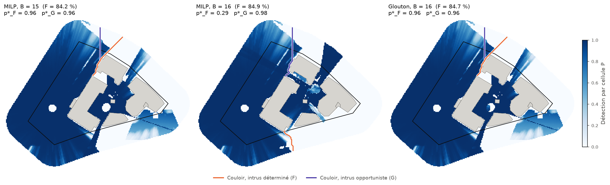
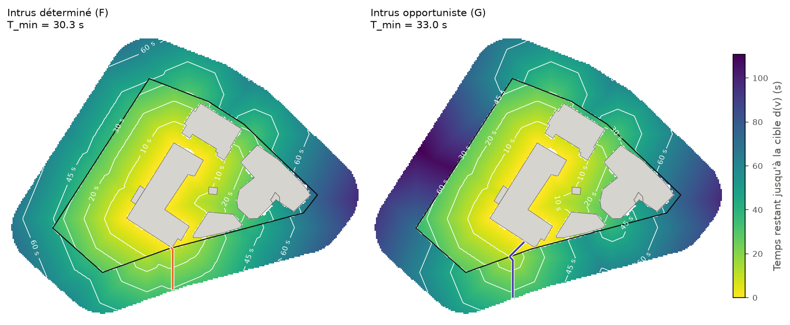
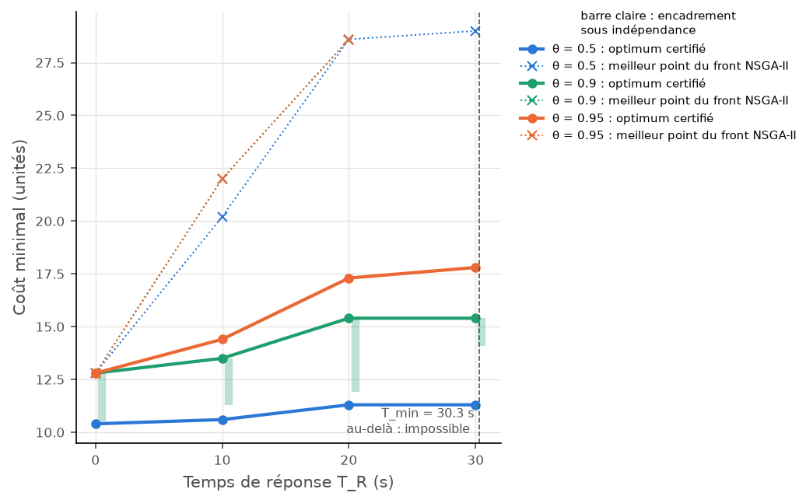
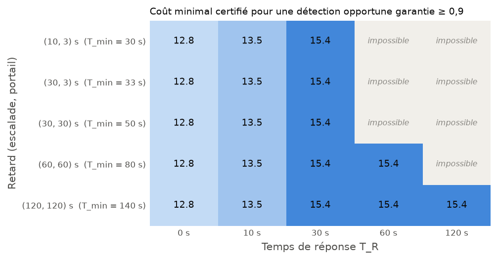
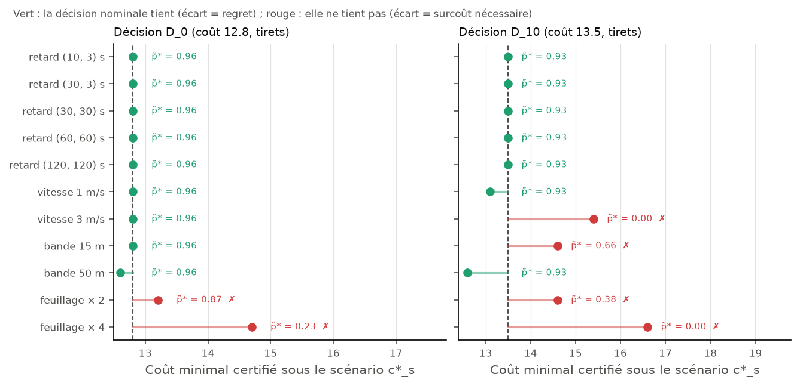

# Couvrir n'est pas protéger : placer des capteurs de surveillance avec un nuage LiDAR, face à un intrus qui réfléchit

*Projet personnel, 8 semaines. Code, preuves et reproduction complète : README et `docs/formulation.md` du dépôt.*

> **Site fictif.** Le site protégé, ses zones et ses actifs sont inventés et superposés à un secteur urbain
> quelconque de Montréal. Publier des cartes d'angles morts d'un site réel serait inacceptable ; ce choix
> fait partie du projet.

## Le problème

On dispose d'un budget pour protéger un site avec des caméras et des radars. Chaque capteur a une position
candidate (mât le long de la clôture, mât intérieur, coin de toit), une hauteur et un modèle de détection.
La question classique est : **où les placer pour couvrir au mieux les zones critiques ?** C'est un problème
de couverture maximale (MCLP), bien connu en recherche opérationnelle.

Ce projet montre que cette question est la mauvaise, puis la remplace par celle que se pose un ingénieur
sûreté : **un intrus qui connaît le dispositif sera-t-il détecté, et assez tôt pour être intercepté ?**

## 1. Le LiDAR donne une probabilité, pas un « visible / invisible »

Un modèle numérique de surface traite un arbre comme un mur. Le nuage LiDAR (MRNF, ≈ 30 points/m², vol de
novembre) permet mieux :

- les **bâtiments sont opaques** ;
- la **végétation est semi-transparente**. Sa densité est estimée par la fraction de trouée des premiers
  retours (loi de Beer-Lambert) et donne une transmittance e^(−τ) le long de chaque ligne de visée.

Le moteur de visibilité parcourt exactement toutes les cellules traversées par chaque rayon (≈ 16 ms pour
500 000 cellules). Il a été validé contre des solutions analytiques. Comparé à `gdal_viewshed`, il était en
désaccord ; un **arbitre exact** a tranché : c'est GDAL qui surestimait la zone visible d'environ 15 %.
Valider contre un outil établi ne suffit pas.

Une idée d'architecture a compté pour toute la suite : **séparer la géométrie du capteur.** L'épaisseur
optique τ ne dépend que de la position et de la hauteur (176 calculs). Les modèles de caméra et de radar, et
toutes leurs orientations, s'appliquent ensuite pour un coût négligeable (4 151 configurations).

## 2. Optimiser la couverture, et le prouver

La couverture pondérée est **sous-modulaire** : chaque capteur ajouté rapporte moins que le précédent. Le
modèle linéaire classique était correct mais inutilisable (36 % d'écart de relaxation). Une décomposition par
**coupes sous-modulaires** donne à la place un encadrement certifié [borne inférieure, borne supérieure] de
l'optimum à chaque budget. Le glouton s'avère quasi optimal au-delà d'un petit budget. On ne le croit pas sur
parole : on le **prouve** par l'encadrement.

## 3. Couvrir n'est pas protéger

Un intrus qui connaît le dispositif ne se promène pas au hasard : il cherche le chemin le moins surveillé.
La bonne métrique est p\*, la **détection garantie sur le pire couloir** : le minimum, sur tous les chemins
de l'extérieur jusqu'à la cible, de la meilleure détection rencontrée. Elle se calcule exactement en une
passe d'union-find (≈ 14 ms), sans hypothèse d'indépendance le long du chemin.

Deux constats :

- **68 % de couverture peuvent laisser un couloir entièrement aveugle** (p\* = 0).
- **Optimiser la moyenne peut ouvrir un trou.** À budget égal, l'optimum de couverture gagne 0,6 point de
  couverture en déplaçant un radar, et perd 67 points de détection garantie.

Un optimiseur multi-objectif (NSGA-II) expose l'arbitrage : au-delà d'un **budget seuil de 12,8 unités**
(deux radars), exiger la robustesse coûte moins de 0,7 point de couverture.

## 4. Le deep learning, là où il sert vraiment (et là où il ne sert pas)

Le plan initial prévoyait un U-Net pour accélérer le calcul des visibilités. **La mesure a tué le plan** :
grâce à la séparation géométrie / capteur, il n'y avait que 176 calculs, et le réseau était 2,6 fois plus
lent que le calcul exact.

La cible a donc été déplacée là où un réseau convolutif a un avantage de structure : la visibilité depuis
*toutes* les positions d'une zone. Résultat honnête :

- un modèle physique simple (angles d'horizon + boosting) **bat les U-Net** ;
- la contribution durable est une **pyramide log-polaire** qui calcule les horizons 38 fois moins cher,
  sans perte mesurable ;
- un modèle précis **ne garantit pas une bonne décision** : choisir un ensemble de capteurs est un problème
  sous-modulaire, qu'un score par position ne capture pas.

Un premier résultat encourageant a été retesté avec un **protocole préenregistré** : il s'est révélé être un
faux positif, et son échec est publié tel quel.

## 5. Détecter n'est pas interrompre

Une détection ne sert que si la réponse arrive avant que l'intrus atteigne sa cible (modèle EASI). On calcule
une fois, pour chaque cellule, le temps minimal qu'il reste à l'intrus pour atteindre la cible.

Sur ce site, le temps d'intrusion minimal est de **30 s** : un coin du bâtiment critique est à 1,2 m de la
clôture. On démontre que **si le temps de réponse dépasse ce seuil, aucun dispositif ne peut protéger**,
quel que soit le budget.

Plus inquiétant : la solution « robuste » à deux radars de l'étape précédente (p\* = 0,97) ne détectait
l'intrus qu'**au contact du bâtiment**. Avec 2,5 s de temps de réponse, sa détection garantie tombe à zéro.

## 6. La boucle optimiseur ↔ intrus, rendue exacte

L'idée intuitive est une boucle : l'optimiseur place les capteurs, l'intrus trouve la faille, l'optimiseur
corrige. Écrite naïvement, elle peut osciller et ne prouve rien.

Écrite comme une **génération de contraintes**, elle converge et certifie :

- la condition « détection ≥ θ » se **linéarise** avec s = −ln(1 − P) ;
- l'intrus devient l'**oracle de séparation** : chaque couloir ouvert qu'il trouve devient une coupe ;
- le maître (MILP) est une relaxation, donc sa borne est valide à chaque itération ; quand l'intrus ne
  trouve plus rien, l'optimum est prouvé.

Rendre la boucle praticable sur 4 151 configurations a demandé cinq accélérations, **toutes exactes** et
chacune choisie sur une mesure. La plus utile : une coupure par la meilleure solution connue, qui transforme
la preuve d'optimalité en preuve d'infaisabilité. Sur 36 instances jouets, le résultat est égal à une
énumération exhaustive.

- Le **seuil de 12,8 unités est prouvé** : NSGA-II l'avait trouvé, la boucle le démontre.
- Exiger une détection opportune coûte **15,4 au lieu de 28,6** pour le meilleur point du front : il suffit
  de le demander à l'optimiseur.
- À budget de 30, la détection opportune garantie passe **de 0 à 0,99** pour moins de 2 points de couverture.

## 7. Le retard est le levier que les capteurs ne remplacent pas

- **Le retard ne rend pas les capteurs moins chers : il rend possibles des temps de réponse qui ne l'étaient
  pas.** Avec clôture et portails à 120 s, une réponse en 2 minutes est couverte pour 15,4 unités.
- **Renforcer la clôture seule ne sert presque à rien** (+2,7 s) : l'intrus passe par un portail. Le retard
  se dimensionne sur le maillon le plus faible.

C'est la triade classique de la protection physique (détecter, retarder, répondre) retrouvée par le calcul.

## 8. Qu'aurait coûté de se tromper ?

Plutôt que de faire varier des métriques, on mesure le **regret de décision** : la décision nominale
tient-elle, et que coûterait de la réparer ? Protocole et prédictions ont été écrits avant le calcul.

- Le **feuillage d'été** et un **intrus qui court** suffisent à casser les décisions nominales ; les réparer
  coûte de 0,4 à 3,1 unités.
- Une prédiction est **réfutée** : j'attendais que le feuillage épargne les radars. Mais un radar est atténué
  à l'aller et au retour, ce qui double l'effet.
- Le vol LiDAR date de novembre : un dimensionnement réel devrait se faire **feuilles comprises**.

## Ce que je retiens

1. **Mesurer avant de construire.** Le goulot de calcul prévu n'existait pas ; le deep learning a été
   déplacé là où il avait un avantage de structure, et comparé à un modèle physique simple.
2. **Certifier plutôt que croire.** Chaque optimum est encadré ou prouvé. Les heuristiques sont jugées
   contre ces bornes, et les accélérations contre une force brute.
3. **Choisir la bonne question.** La couverture moyenne, la détection garantie, puis la détection *à temps* :
   chaque changement de métrique a révélé une faille que la précédente cachait.
4. **Publier les échecs.** Un faux positif démasqué par un protocole préenregistré, une prédiction réfutée :
   ils sont dans le README, au même rang que les succès.

## Limites

Visibilité statique (un seul vol, sans feuilles), coûts relatifs non calibrés, intrus debout et omniscient,
temps de réponse déterministe, sensibilité un facteur à la fois. La liste complète est dans le README.

---

*Stack : PDAL, laspy, rasterio, numpy / numba, scipy (HiGHS), pymoo, PyTorch, Streamlit.
Données : © Gouvernement du Québec, MRNF, licence CC BY 4.0.*
